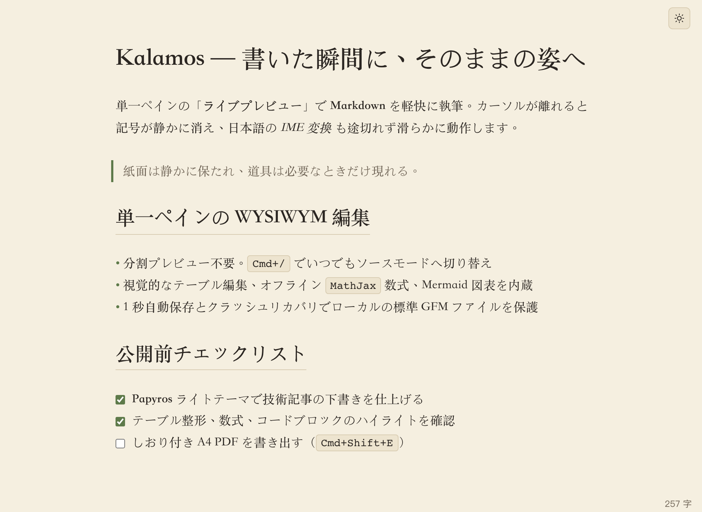
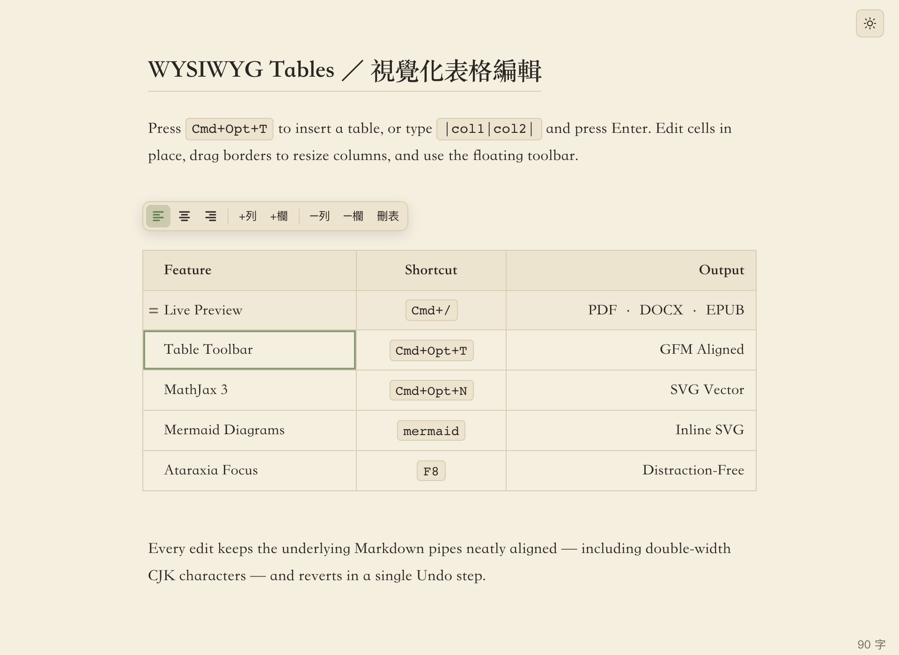
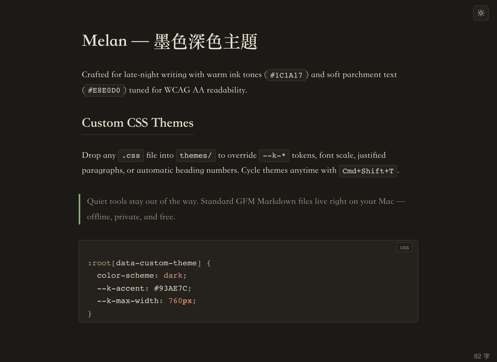

<p align="center">
  
</p>

<h1 align="center">Kalamos</h1>

<p align="center">
  <strong>Write, and it appears. ／ 書いた瞬間に、そのままの姿へ。</strong><br />
  Tauri 2 と CodeMirror 6 で構築した macOS 向け Typora 風 WYSIWYM ライブプレビュー Markdown エディタ。<br />
  無料・完全オフライン・アカウント不要・テレメトリなし。
</p>

<p align="center">
  <a href="README.md">English</a> ·
  <a href="README.zh-TW.md">繁體中文</a> ·
  <strong>日本語</strong> ·
  <a href="README.ko.md">한국어</a>
</p>

<p align="center">
  
</p>

> **Kalamos**（*κάλαμος*、発音：*KA-la-mos*）は、古代ギリシャ語でパピルスに文字を記すための「葦ペン」を意味します。道具は必要になるまで静かに隠れ、ドキュメントは標準的で可搬性の高い GitHub Flavored Markdown（GFM）のままローカルに保存されます。

---

## 主な機能

### ライブプレビュー編集（WYSIWYM）
- **単一ペインのライブプレビュー**（`ED-01`）：見出し、**太字**、*斜体*、~~取り消し線~~、`インラインコード`、リンク、引用、水平線、リストを閉じ記号の入力と同時に描画。カーソルが離れると記号を隠し、戻ると穏やかに再表示します。
- **ソースモード**（`ED-02`）：`Cmd+/` でいつでも生の Markdown 表示へ切り替えられ、カーソル位置も維持されます。
- **CJK・IME に配慮した書き心地**：全角句読点に隣接する強調構文を正しく解釈し、IME 変換中は装飾の再計算を凍結して画面のガタつきを防止。未編集ファイルの保存時は元の CRLF/LF 改行コードと UTF-8 BOM をそのまま保持します。
- **リストとタスクリスト**（`ED-04`）：箇条書き、番号付きリスト、クリックで切り替えられる GFM タスクリスト（`- [ ]` / `- [x]`）に対応。`Tab` / `Shift+Tab` による階層調整、`Enter` / `Backspace` による継続・終了、ショートカットでのリスト種別切り替えが可能です。
- **リンクと見出しブックマーク**（`ED-05`）：外部 URL（`http://`、`https://`、`mailto:`）、相対パスの `.md` リンク、文書内の `#見出し` ジャンプに対応。`Cmd+Shift+C` で見出しブックマーク用リンクをコピーできます。
- **各種ブロックと自動 `[TOC]`**（`ED-06`、`ED-07`）：引用、水平線、YAML Front Matter、ホバープレビューとクリックジャンプに対応した脚注、見出しに連動して自動更新される `[TOC]` 目次を備えています。
- **絵文字オートコンプリート**（`ED-08`）：`:name` の入力で GitHub `gemoji` 候補をオフライン表示（初回入力時に遅延読み込み）。
- **自動ペア補完**（`ED-09`）：半角および全角の括弧・引用符（`() [] {} "" ''` と `「」『』（）【】《》“”‘’`）を自動補完（デフォルト有効、`Cmd+Opt+P`）。Markdown 記号 `* _ ` ~` の補完もオプションで切り替え可能です（`Cmd+Opt+Shift+P`）。

### テーブル編集
- **WYSIWYG GFM テーブル**（`BL-01`）：セル内で直接編集でき、`Tab` / `Shift+Tab` / `Enter` で移動、`Cmd+Enter` でテーブル外へ抜けられます。
- **素早い挿入**：`Cmd+Opt+T` で挿入ダイアログ（グリッド選択・行数／列数指定）を開くか、`|a|b|` と入力して `Enter` を押すだけでテーブルに変換できます。
- **フローティングツールバーとコンテキストメニュー**：編集中のテーブル上部に本文を覆わない専用領域でツールバーを表示（スクロール位置を補正してガタつきを防止）。右クリックメニューからも同じ操作を実行できます。
- **構造変更と揃え**：行・列の追加／削除、境界ドラッグによる列幅調整、左揃え・中央揃え・右揃えの切り替え、列の左右移動、テーブル削除に対応。各操作は 1 回の Undo で元に戻せ、全角文字幅（幅 2）を考慮して Markdown ソースの区切り線も自動整形されます。詳細は [docs/tables.md](docs/tables.md) を参照してください。

<p align="center">
  
</p>

### 数式・ダイアグラム・コードブロック
- **コードブロック**（`BL-02`）：`@codemirror/language-data` により 100 言語以上のシンタックスハイライトに対応。目に優しい低彩度カラーで、`Cmd+Opt+L` により行番号の表示を切り替えられます。
- **数式**（`BL-03`）：オフラインの MathJax 3 SVG エンジンでインライン `$...$` とディスプレイ `$$...$$` 数式を描画。`ams`、`mhchem`（化学式）、`bbox`、`newcommand` パッケージを内蔵し、ビューポート内のみ遅延描画・編集中ブロック下部のライブプレビュー・AMS 自動番号付け（`Cmd+Opt+N`）に対応します。
- **ダイアグラム**（`BL-04`）：`mermaid`、`flow`（flowchart.js 構文）、`sequence`（js-sequence-diagrams 構文）を現在のテーマ配色に合わせた安全な SVG としてオフライン描画。編集中はデバウンス付きプレビューと行番号付きの構文エラー表示を行います。

<p align="center">
  
</p>

### 画像とカスタムアップロード
- **インライン画像プレビュー**（`IM-01`）：ローカル画像およびリモート画像を本文内にそのまま表示します。
- **ドラッグ＆ドロップと貼り付け**（`IM-02`）：画像をドロップまたはペーストすると、文書と同じ階層の `assets/` フォルダにコピーし、相対パスの Markdown リンクを挿入します。
- **サイズ・ズーム指定**（`IM-03`）：`width`、`height`、`style="zoom: ...%"` を指定した HTML `` タグに対応します。
- **画像ルートフォルダ**（`IM-04`）：`Cmd+Opt+R`（解除は `Cmd+Opt+Shift+R`）または YAML Front Matter の `typora-root-url` でルート基準フォルダを設定し、静的サイト向けの `/` 始まりパスを解決できます。
- **カスタム CLI アップローダ**（`IM-05`）：`Cmd+Opt+U`（または `uploadOnInsert` 設定）で PicGo CLI などの外部コマンドを呼び出し、ローカル画像をアップロードして URL へ自動置換します。安全のためアップロードコマンドは `settings.json` からのみ設定可能です。詳細は [docs/image-upload.md](docs/image-upload.md) を参照してください。

### エクスポートとインポート
- **ネイティブ PDF エクスポート**（`EX-01`、`Cmd+Shift+E`）：JavaScript 無効の非表示 `WKWebView` と `NSPrintOperation` で A4 ページ組版し、`PDFKit` で見出し階層に対応したネスト済み PDF しおり（アウトライン）を自動付与します。数式やダイアグラムも描画されます。
- **Pandoc エクスポート**（`EX-02`、`Cmd+Opt+E`）：**DOCX**、**ODT**（OpenOffice / LibreOffice）、**LaTeX**、**MediaWiki**、**EPUB** への書き出しに対応（別途 Pandoc が必要）。`[TOC]` やローカル画像パス、`` サイズ指定も自動変換します。
- **Pandoc インポート**（`EX-03`、`Cmd+Opt+I`）：**DOCX**、**ODT**、**EPUB**、**LaTeX**、**HTML**、**MediaWiki** を `$...$` / `$$...$$` 数式や抽出メディア付きのクリーンな GFM Markdown として取り込めます（`--sandbox` のため Pandoc 2.15 以上が必要）。

### ライティングモード
- **Ataraxia フォーカスモード**（`WM-01`、`F8`）：現在の段落・リスト項目・選択範囲以外のブロックを穏やかにフェードアウトします。
- **Stichos タイプライターモード**（`WM-02`、`F9`）：入力中もカーソル行を常に画面の垂直中央に保ちます。

### テーマシステム
- **内蔵テーマ**（`TH-01`）：**Papyros**（温かみのある紙色ライト）、**Melan**（墨色ダーク）、およびシステム連動（`prefers-color-scheme`）を用意。オープンソース書体（`Source Serif 4`、`Noto Serif TC`、`Inter`、`Noto Sans TC`、`JetBrains Mono`）を同梱しています。
- **カスタム CSS テーマ**：`~/Library/Application Support/io.kalamos.app/themes/` に `.css` ファイルを配置することで、`--k-*` 変数、文字サイズ、両端揃え、見出しの自動連番まで自由にカスタマイズ可能です。テーマメニューまたは `Cmd+Shift+T` で切り替えられます。詳細は [docs/themes.md](docs/themes.md) を参照してください。

<p align="center">
  
</p>

### ファイル管理・サイドバー・信頼性
- **サイドバー**（`NV-01`、`NV-02`）：`Cmd+Shift+L` で表示切り替え、`Cmd+Shift+O` でフォルダを開けます。**ファイルツリー**、**ファイル一覧**（抜粋付き）、**アウトライン**（見出しジャンプ）を切り替え可能。新規作成・リネーム・ゴミ箱移動および外部変更の自動監視（iCloud Drive / Dropbox フォルダ対応）を備えています。
- **文字数・単語数カウント**（`NV-03`）：ステータスバーに読者視点の単語数（CJK 文字 + 英単語）、書記素文字数、行数、推定読了時間をリアルタイム表示。範囲選択中は選択部分の統計に切り替わります。
- **安全な保存とクラッシュリカバリ**：一時ファイル経由の原子的リネーム保存、保存済みファイルの 1 秒デバウンス自動保存、無題ドラフトの 5 秒間隔リカバリスナップショットと次回起動時のワンクリック復元バナーを実装しています。

---

## キーボードショートカット

| カテゴリ | 操作 | ショートカット |
| --- | --- | --- |
| **ファイル** | 新規ドキュメント | `Cmd+N` |
| | ファイルを開く | `Cmd+O` |
| | 保存 / 名前を付けて保存 | `Cmd+S` / `Cmd+Shift+S` |
| | フォルダを開く | `Cmd+Shift+O` |
| **表示・モード** | ソースモード切り替え | `Cmd+/` |
| | サイドバー切り替え | `Cmd+Shift+L` |
| | テーマを順番に切り替え | `Cmd+Shift+T` |
| | Ataraxia フォーカスモード | `F8` |
| | Stichos タイプライターモード | `F9` |
| **書式・リスト** | 太字 / 斜体 | `Cmd+B` / `Cmd+I` |
| | インラインコード | `Cmd+Shift+`` ` `` |
| | リンクの挿入・解除 | `Cmd+K` |
| | 番号付き / 箇条書き / タスクリスト | `Cmd+Shift+[` / `Cmd+Shift+]` / `Cmd+Shift+X` |
| | リストのインデント / インデント解除 | `Tab` / `Shift+Tab` |
| | 見出しブックマークリンクをコピー | `Cmd+Shift+C` |
| **ブロック・入力** | コード行番号の表示切り替え | `Cmd+Opt+L` |
| | 数式の自動番号付け切り替え | `Cmd+Opt+N` |
| | 括弧 / Markdown 記号の自動ペア切り替え | `Cmd+Opt+P` / `Cmd+Opt+Shift+P` |
| **テーブル** | テーブル挿入ダイアログ | `Cmd+Opt+T` |
| | 次 / 前のセルへ移動 | `Tab` / `Shift+Tab` |
| | テーブルを抜ける | `Cmd+Enter` |
| | 上 / 下に行を挿入 | `Cmd+Opt+↑` / `Cmd+Opt+↓` |
| | 左 / 右に列を挿入 | `Cmd+Opt+←` / `Cmd+Opt+→` |
| | 行 / 列を削除 | `Cmd+Shift+Backspace` / `Cmd+Opt+Backspace` |
| | 列を左揃え / 中央揃え / 右揃え | `Cmd+Opt+Shift+←` / `↑` / `→` |
| **画像** | 画像ルートフォルダを設定 / 解除 | `Cmd+Opt+R` / `Cmd+Opt+Shift+R` |
| | ローカル画像をアップロード | `Cmd+Opt+U` |
| **入出力** | PDF エクスポート（しおり付き） | `Cmd+Shift+E` |
| | Pandoc エクスポート（DOCX/ODT/LaTeX/Wiki/EPUB） | `Cmd+Opt+E` |
| | Pandoc インポート | `Cmd+Opt+I` |

---

## インストール（macOS）

1. [GitHub Releases](https://github.com/kkdai/Kalamos/releases) から最新の `.dmg` をダウンロードします。
2. `.dmg` を開き、**Kalamos.app** を `/Applications` へドラッグします。
3. **未署名ビルドの起動方法**：現在、リリースビルドは Apple 公証（Notarization）未取得のため、初回起動時に macOS Gatekeeper にブロックされる場合があります。次のいずれかで起動してください：
   - **方法 A（Finder）**：**Kalamos.app** を右クリック（または Control+クリック）→「**開く**」→ 確認ダイアログで「**開く**」を選択（または **システム設定 → プライバシーとセキュリティ** で「**このまま開く**」をクリック）。
   - **方法 B（ターミナル）**：隔離属性を解除します：
     ```bash
     xattr -cr /Applications/Kalamos.app
     ```

---

## ソースからのビルド

### 必要環境
- **macOS** および Xcode Command Line Tools（`xcode-select --install`）
- **Node.js** 22 以上および npm
- **Rust** stable ツールチェーン（`rustup`）
- **Pandoc** *（任意）* — DOCX / ODT / LaTeX / MediaWiki / EPUB のエクスポート・インポート利用時のみ必要（インポートには 2.15 以上が必要）：
  ```bash
  brew install pandoc
  ```

### ビルド手順
```bash
npm ci
npm run tauri build
```

ビルドされた `.app` および `.dmg` は `src-tauri/target/release/bundle/` に生成されます。

---

## 開発・テストコマンド

```bash
# フロントエンド Vite 開発サーバ起動（ポート 1420、ブラウザでは IPC モックで動作）
npm run dev

# Tauri デスクトップアプリを開発モードで起動
npm run tauri dev

# TypeScript 型チェックとフロントエンドビルド
npm run build

# フロントエンド単体テスト（Vitest）
npm test

# E2E テスト（Playwright、IPC モック環境）
npm run test:e2e

# Rust バックエンドテストと Clippy チェック
cargo test --manifest-path src-tauri/Cargo.toml
cargo clippy --manifest-path src-tauri/Cargo.toml --all-targets -- -D warnings

# 10,000 行ドキュメントのパフォーマンスベンチマーク
npm run bench
```

---

## 既知の制限事項

- **macOS 専用**：ネイティブ PDF エクスポートが macOS の `WKWebView`・`NSPrintOperation`・`PDFKit` に依存しているため、Windows / Linux パッケージには現在未対応です。
- **GUI 設定画面は未実装**：主要な切り替えはショートカットから行え `~/Library/Application Support/io.kalamos.app/settings.json` に自動保存されますが、画像アップローダ設定（`uploadCommand`、`uploadArgs`、`uploadOnInsert`）は同 JSON ファイルを直接編集する必要があります。
- **Pandoc は外部ツール**：多形式エクスポート（`EX-02`）とインポート（`EX-03`）には別途 Pandoc のインストールが必要です（サンドボックス実行を伴うインポートは 2.15 以上）。
- **未署名ビルド**：配布 `.dmg` の初回起動時は macOS Gatekeeper での許可が必要です。
- **iPic プリセット未内蔵**：macOS 向け iPic の組み込みプリセットはありませんが、標準出力に URL を返す CLI ツールであれば `uploadCommand` に指定できます。
- **設計上の対象外**：アカウント制、独自クラウド同期（iCloud / Dropbox フォルダを利用）、リアルタイム共同編集、プラグインマーケット、内蔵 AI アシスタントは提供しません。

---

## ドキュメント

- 製品要件定義書：[docs/PRD.md](docs/PRD.md)
- テーブルガイド：[docs/tables.md](docs/tables.md)
- カスタム CSS テーマガイド：[docs/themes.md](docs/themes.md)
- 画像アップロード設定ガイド：[docs/image-upload.md](docs/image-upload.md)

---

## ライセンス

TBD
