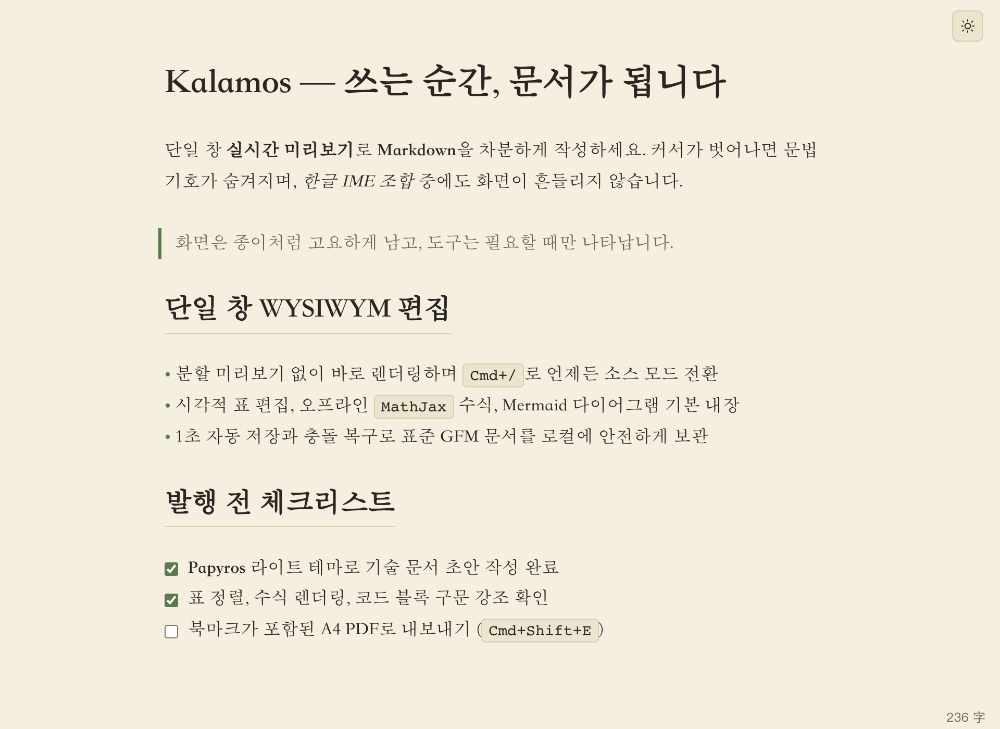
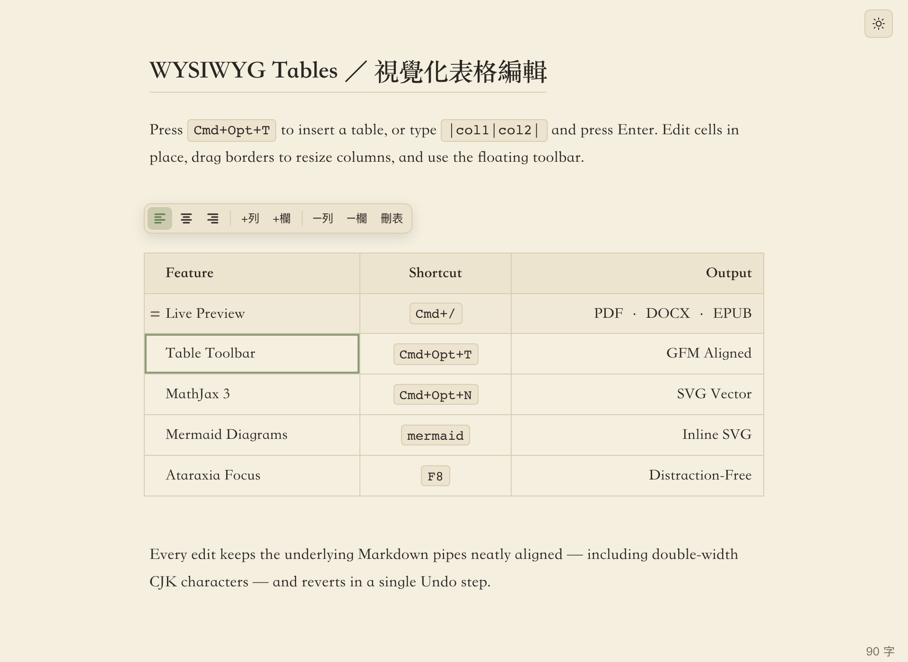
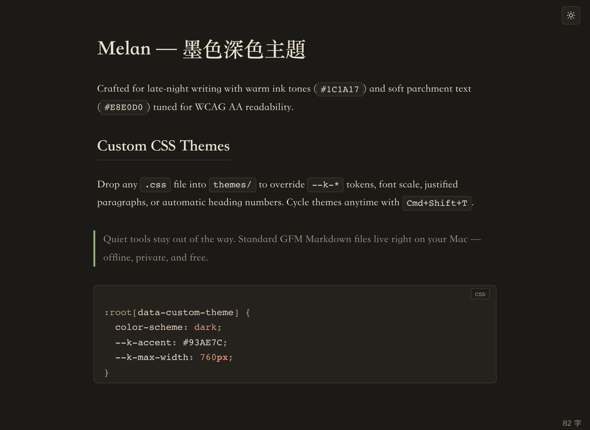
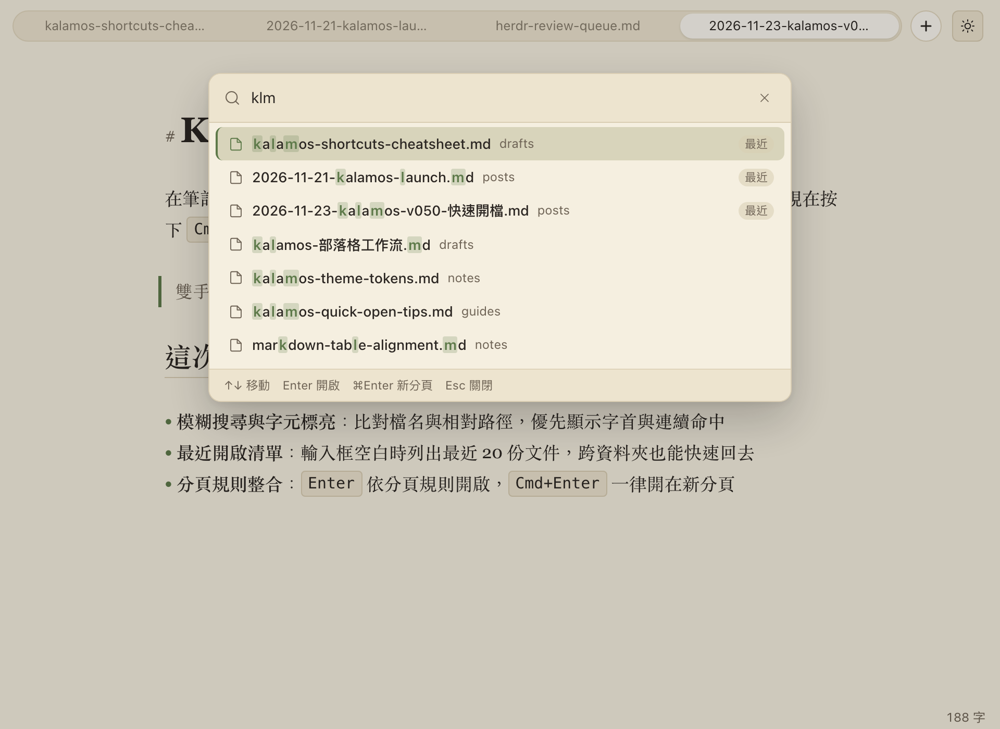

<p align="center">
  
</p>

<h1 align="center">Kalamos</h1>

<p align="center">
  <strong>Write, and it appears. ／ 쓰는 순간, 그대로 문서가 됩니다.</strong><br />
  Tauri 2와 CodeMirror 6으로 만든 macOS 및 Windows용 Typora 스타일 WYSIWYM 실시간 미리보기 Markdown 에디터.<br />
  무료, 완전 오프라인, 계정 불필요, 텔레메트리 없음.
</p>

<p align="center">
  <a href="README.md">English</a> ·
  <a href="README.zh-TW.md">繁體中文</a> ·
  <a href="README.ja.md">日本語</a> ·
  <strong>한국어</strong>
</p>

<p align="center">
  
</p>

> **Kalamos**(*κάλαμος*, 발음: *KA-la-mos*)는 고대 그리스어로 파피루스에 글씨를 쓰던 '갈대 펜'을 뜻합니다. 도구는 필요할 때만 조용히 나타나고, 모든 문서는 표준 호환 GitHub Flavored Markdown(GFM) 형식으로 로컬에 저장됩니다.

---

## 주요 기능

### 실시간 미리보기 편집 (WYSIWYM)
- **단일 창 실시간 렌더링**(`ED-01`): 제목, **굵게**, *기울임*, ~~취소선~~, `인라인 코드`, 링크, 인용문, 구분선, 목록을 닫는 기호를 입력하는 즉시 렌더링합니다. 커서가 벗어나면 문법 기호를 숨기고, 돌아오면 부드럽게 다시 보여줍니다.
- **소스 모드**(`ED-02`): `Cmd+/`로 커서 위치를 유지한 채 언제든 순수 Markdown 소스 보기로 전환할 수 있습니다.
- **CJK 및 IME 친화적 편집**: 전각 문장부호 옆의 강조 구문을 정확히 처리하며, 한글·한자 등 IME 조합 중에는 장식 갱신을 일시 멈춰 화면 흔들림을 방지합니다. 수정하지 않은 파일은 기존 CRLF/LF 줄바꿈과 UTF-8 BOM을 그대로 보존합니다.
- **목록과 할 일 목록**(`ED-04`): 글머리 기호, 번호 매기기, 클릭으로 체크할 수 있는 GFM 할 일 목록(`- [ ]` / `- [x]`)을 지원합니다. `Tab` / `Shift+Tab`으로 들여쓰기를 조절하고 `Enter` / `Backspace`로 자연스럽게 목록과 인용문을 이어가거나 빠져나올 수 있습니다.
- **링크와 제목 북마크**(`ED-05`): 외부 URL(`http://`, `https://`, `mailto:`), 상대 경로 `.md` 링크, 문서 내 `#제목` 이동을 지원하며 `Cmd+Shift+C`로 제목 북마크 링크를 복사할 수 있습니다.
- **풍부한 블록과 실시간 `[TOC]`**(`ED-06`, `ED-07`): 인용문, 가로 구분선, YAML Front Matter, 마우스 오버 미리보기 및 클릭 이동을 지원하는 각주, 제목 변경에 맞춰 자동 갱신되는 `[TOC]` 목차를 제공합니다.
- **이모지 자동 완성**(`ED-08`): `:name`을 입력하면 오프라인 GitHub `gemoji` 후보를 표시합니다(최초 사용 시 지연 로드).
- **자동 짝 맞추기**(`ED-09`): 영문 및 전각 괄호·따옴표(`() [] {} "" ''`, `「」『』（）【】《》“”‘’`)를 자동 완성하며(기본 켜짐, `Cmd+Opt+P`), Markdown 기호 `* _ ` ~` 자동 짝 맞추기도 선택적으로 켤 수 있습니다(`Cmd+Opt+Shift+P`).

### 표 편집
- **WYSIWYG GFM 표**(`BL-01`): 셀 안에서 바로 내용을 편집하고 `Tab`, `Shift+Tab`, `Enter`로 이동할 수 있으며 `Cmd+Enter`로 표 밖으로 빠져나옵니다.
- **빠른 표 삽입**: `Cmd+Opt+T`로 표 삽입 대화상자(그리드 선택기 또는 행/열 입력)를 열거나, `|a|b|`를 입력하고 `Enter`를 눌러 즉시 표로 변환할 수 있습니다.
- **플로팅 툴바와 컨텍스트 메뉴**: 표 안에 커서가 있으면 본문을 가리지 않도록 표 위쪽 여백에 툴바가 나타나며(스크롤 위치 보정으로 화면 튐 방지), 우클릭 메뉴에서도 동일한 기능을 제공합니다.
- **구조 편집 및 정렬**: 행·열 추가/삭제, 경계 드래그로 열 너비 조절, 왼쪽/가운데/오른쪽 정렬 토글, 열 좌우 이동, 표 삭제를 지원합니다. 모든 작업은 한 번의 Undo로 되돌릴 수 있으며 전각 문자 너비(너비 2)를 반영해 Markdown 소스의 파이프도 깔끔하게 정렬합니다. 자세한 내용은 [docs/tables.md](docs/tables.md)를 참고하세요.

<p align="center">
  
</p>

### 수식, 다이어그램, 코드 블록
- **코드 블록**(`BL-02`): `@codemirror/language-data` 기반 100여 개 언어 구문 강조와 저채도 테마 배색을 제공하며 `Cmd+Opt+L`로 줄 번호를 켜고 끌 수 있습니다.
- **수학 수식**(`BL-03`): 오프라인 MathJax 3 SVG로 인라인 `$...$` 및 블록 `$$...$$` 수식을 렌더링합니다. `ams`, `mhchem`(화학식), `bbox`, `newcommand` 확장을 포함하며, 뷰포트에 보이는 수식만 지연 렌더링하고 편집 중인 블록 아래에 실시간 미리보기를 표시합니다. `Cmd+Opt+N`으로 AMS 자동 번호 매기기를 전환할 수 있습니다.
- **다이어그램**(`BL-04`): `mermaid`, `flow`(flowchart.js 문법), `sequence`(js-sequence-diagrams 문법)를 현재 테마 색상에 맞춘 안전한 SVG로 오프라인 렌더링하며, 디바운스 미리보기와 줄 번호가 포함된 구문 오류 메시지를 제공합니다.

<p align="center">
  
</p>

### 이미지와 커스텀 업로드
- **인라인 이미지 미리보기**(`IM-01`): 로컬 및 원격 이미지를 문서 안에서 바로 표시합니다.
- **드래그 앤 드롭 및 붙여넣기**(`IM-02`): 이미지를 끌어다 놓거나 붙여넣으면 문서 옆 `assets/` 폴더에 저장하고 상대 경로 링크를 삽입합니다.
- **크기 및 배율 조절**(`IM-03`): `width`, `height`, `style="zoom: ...%"` 속성이 포함된 HTML `` 태그를 지원합니다.
- **이미지 루트 폴더**(`IM-04`): `Cmd+Opt+R`(해제는 `Cmd+Opt+Shift+R`) 또는 YAML Front Matter의 `typora-root-url`로 정적 블로그용 `/` 기준 경로를 해석합니다.
- **커스텀 CLI 업로더**(`IM-05`): `Cmd+Opt+U`(또는 `uploadOnInsert` 옵션)로 PicGo CLI 같은 외부 명령을 실행해 로컬 이미지를 업로드하고 원격 URL로 자동 치환합니다. 보안을 위해 업로드 명령은 `settings.json`에서만 설정할 수 있습니다. 자세한 내용은 [docs/image-upload.md](docs/image-upload.md)를 참고하세요.

### 내보내기 및 가져오기
- **네이티브 PDF 내보내기**(`EX-01`, `Cmd+Shift+E`): A4 페이지네이션과 제목 계층에 맞춘 중첩 PDF 북마크(개요)를 자동 생성하며, 렌더링된 수식과 다이어그램도 그대로 포함합니다(macOS는 `WKWebView`·`NSPrintOperation`·`PDFKit`, Windows는 헤드리스 Microsoft Edge 또는 Google Chrome 사용).
- **Pandoc 내보내기**(`EX-02`, `Cmd+Opt+E`): **DOCX**, **ODT**(OpenOffice / LibreOffice), **LaTeX**, **MediaWiki**, **EPUB** 형식으로 내보낼 수 있습니다(Pandoc 별도 설치 필요). `[TOC]`, 로컬 이미지 경로, `` 크기 속성을 자동으로 변환합니다.
- **Pandoc 가져오기**(`EX-03`, `Cmd+Opt+I`): **DOCX**, **ODT**, **EPUB**, **LaTeX**, **HTML**, **MediaWiki** 문서를 `$...$` / `$$...$$` 수식과 추출된 미디어가 포함된 깔끔한 GFM Markdown으로 가져옵니다(`--sandbox` 사용을 위해 Pandoc 2.15 이상 필요).

### 글쓰기 모드
- **Ataraxia 집중 모드**(`WM-01`, `F8`): 현재 작성 중인 문단·목록 항목·선택 영역을 제외한 나머지 블록을 부드럽게 흐리게 표시합니다.
- **Stichos 타자기 모드**(`WM-02`, `F9`): 입력하는 동안 현재 커서 줄이 화면 세로 중앙에 머물도록 유지합니다.

### 테마 시스템
- **기본 제공 테마**(`TH-01`): **Papyros**(따뜻한 파피루스 라이트), **Melan**(먹색 다크), 시스템 자동 전환(`prefers-color-scheme`)을 지원하며 오픈소스 서체(`Source Serif 4`, `Noto Serif TC`, `Inter`, `Noto Sans TC`, `JetBrains Mono`)를 내장했습니다.
- **커스텀 CSS 테마**: `~/Library/Application Support/io.kalamos.app/themes/`(macOS) 또는 `%APPDATA%\io.kalamos.app\themes\`(Windows)에 `.css` 파일을 추가해 `--k-*` 변수, 글꼴 크기, 양쪽 정렬, 자동 제목 번호 등을 자유롭게 꾸밀 수 있습니다. 테마 메뉴 또는 `Cmd+Shift+T`로 전환합니다. 자세한 내용은 [docs/themes.md](docs/themes.md)를 참고하세요.

<p align="center">
  
</p>

### 빠른 열기, 탭, 검색 및 파일 관리
- **빠른 열기 및 최근 파일**(`Cmd+P` / `Ctrl+P`): 열려 있는 폴더의 Markdown 파일을 퍼지 검색하고 일치한 문자를 강조 표시합니다(파일명·접두사·연속 일치 우선). 입력창이 비어 있을 때는 폴더에 관계없이 최근에 연 파일 최대 20개를 보여주며, `Enter`로 탭 규칙에 따라 열거나 `Cmd+Enter` / `Ctrl+Enter`로 항상 새 탭에서 열 수 있습니다. macOS와 Windows 네이티브 메뉴의 **파일 > 최근 항목 열기**(목록 지우기 포함)에서도 바로 열 수 있습니다.
- **다중 문서 탭**: 한 창에서 여러 문서를 동시에 편집합니다(`Cmd+T` / `Ctrl+T` 새 탭, `Cmd+W` / `Ctrl+W` 탭 닫기, `Ctrl+Tab` / `Ctrl+Shift+Tab` 탭 전환, 드래그로 순서 변경). 각 탭이 독립적인 실행 취소 기록·커서·스크롤 위치를 유지하며, 창을 닫거나 종료하기 전 저장되지 않은 변경 사항을 안내합니다.
- **찾기·바꾸기 및 폴더 검색**: 현재 문서 내 찾기(`Cmd+F` / `Ctrl+F`)와 찾기 및 바꾸기(`Cmd+Opt+F` / `Ctrl+Alt+F`), 사이드바에서 열려 있는 폴더 전체의 Markdown 파일을 검색하는 폴더 검색(`Cmd+Shift+F` / `Ctrl+Shift+F`)을 지원합니다.
- **네이티브 메뉴 막대와 환경설정**: macOS와 Windows 모두 네이티브 메뉴 막대를 제공하며, `Cmd+,` / `Ctrl+,`로 환경설정 창을 열어 일반·에디터·테마·이미지 옵션을 조정할 수 있습니다.
- **사이드바**(`NV-01`, `NV-02`): `Cmd+Shift+L` / `Ctrl+Shift+L`로 토글하고 `Cmd+Shift+O` / `Ctrl+Shift+O`로 폴더를 엽니다. **파일 트리**, **파일 목록**(미리보기 발췌 포함), **개요**(`Cmd+Shift+1` / `Ctrl+Shift+1`), **폴더 검색** 탭을 제공하며 파일 생성·이름 변경·휴지통 이동과 외부 파일 변경 실시간 감지(iCloud Drive / Dropbox 폴더 호환)를 지원합니다.
- **글자 수·단어 수 통계**(`NV-03`): 상태 표시줄에서 마크업을 제외한 실제 단어 수(CJK + 영문), 글자 수, 줄 수, 예상 읽기 시간을 실시간으로 보여주며 텍스트 선택 시 선택 영역 통계를 표시합니다.
- **안전한 저장과 충돌 복구**: 임시 파일 작성 후 원자적 이름 바꾸기 저장, 저장된 파일의 1초 디바운스 자동 저장, 제목 없는 초안의 5초 간격 복구 스냅샷 및 재실행 시 원클릭 복원 배너를 지원합니다.

<p align="center">
  
</p>

---

## 단축키 목록

| 분류 | 기능 | macOS | Windows |
| --- | --- | --- | --- |
| **파일 및 탭** | 새 문서 | `Cmd+N` | `Ctrl+N` |
| | 새 탭 | `Cmd+T` | `Ctrl+T` |
| | 파일 열기 | `Cmd+O` | `Ctrl+O` |
| | 빠른 열기(퍼지 검색 및 최근 파일) | `Cmd+P` | `Ctrl+P` |
| | 사이드바에서 폴더 열기 | `Cmd+Shift+O` | `Ctrl+Shift+O` |
| | 저장 / 다른 이름으로 저장 | `Cmd+S` / `Cmd+Shift+S` | `Ctrl+S` / `Ctrl+Shift+S` |
| | 탭 닫기 | `Cmd+W` | `Ctrl+W` |
| | 다음 / 이전 탭 전환 | `Ctrl+Tab` / `Ctrl+Shift+Tab` | `Ctrl+Tab` / `Ctrl+Shift+Tab` |
| | 환경설정 | `Cmd+,` | `Ctrl+,` |
| **검색** | 문서에서 찾기 | `Cmd+F` | `Ctrl+F` |
| | 찾기 및 바꾸기 | `Cmd+Opt+F` | `Ctrl+Alt+F` |
| | 다음 / 이전 찾기 | `Cmd+G` / `Cmd+Shift+G` | `Ctrl+G` / `Ctrl+Shift+G` |
| | 폴더에서 찾기 | `Cmd+Shift+F` | `Ctrl+Shift+F` |
| **보기 및 모드** | 소스 모드 전환 | `Cmd+/` | `Ctrl+/` |
| | 사이드바 표시/숨기기 | `Cmd+Shift+L` | `Ctrl+Shift+L` |
| | 개요 표시/숨기기 | `Cmd+Shift+1` | `Ctrl+Shift+1` |
| | 테마 순환 전환 | `Cmd+Shift+T` | `Ctrl+Shift+T` |
| | Ataraxia 집중 모드 | `F8` | `F8` |
| | Stichos 타자기 모드 | `F9` | `F9` |
| | 확대 / 축소 / 실제 크기 | `Cmd+Shift+=` / `-` / `0` | `Ctrl+Shift+=` / `-` / `0` |
| **서식 및 목록** | 제목 1–6 / 본문 문단 | `Cmd+1`–`6` / `Cmd+0` | `Ctrl+1`–`6` / `Ctrl+0` |
| | 굵게 / 기울임 / 취소선 | `Cmd+B` / `Cmd+I` / `Cmd+Shift+D` | `Ctrl+B` / `Ctrl+I` / `Ctrl+Shift+D` |
| | 인라인 코드 | `Cmd+Shift+`` ` `` | `Ctrl+Shift+`` ` `` |
| | 링크 삽입/해제 | `Cmd+K` | `Ctrl+K` |
| | 번호 / 글머리 / 할 일 목록 | `Cmd+Shift+[` / `Cmd+Shift+]` / `Cmd+Shift+X` | `Ctrl+Shift+[` / `Ctrl+Shift+]` / `Ctrl+Shift+X` |
| | 목록 들여쓰기 / 내어쓰기 | `Tab` / `Shift+Tab` | `Tab` / `Shift+Tab` |
| | 제목 북마크 링크 복사 | `Cmd+Shift+C` | `Ctrl+Shift+C` |
| **블록 및 입력** | 코드 블록 / 수식 블록 / 인용문 | `Cmd+Opt+C` / `B` / `Q` | `Ctrl+Alt+C` / `B` / `Q` |
| | 코드 줄 번호 전환 | `Cmd+Opt+L` | `Ctrl+Alt+L` |
| | 수식 자동 번호 매기기 전환 | `Cmd+Opt+N` | `Ctrl+Alt+N` |
| | 괄호 / Markdown 기호 자동 짝 전환 | `Cmd+Opt+P` / `Cmd+Opt+Shift+P` | `Ctrl+Alt+P` / `Ctrl+Alt+Shift+P` |
| **표** | 표 삽입 대화상자 | `Cmd+Opt+T` | `Ctrl+Alt+T` |
| | 다음 / 이전 셀 이동 | `Tab` / `Shift+Tab` | `Tab` / `Shift+Tab` |
| | 표 밖으로 나가기 | `Cmd+Enter` | `Ctrl+Enter` |
| | 위 / 아래에 행 추가 | `Cmd+Opt+↑` / `Cmd+Opt+↓` | `Ctrl+Alt+↑` / `Ctrl+Alt+↓` |
| | 왼쪽 / 오른쪽에 열 추가 | `Cmd+Opt+←` / `Cmd+Opt+→` | `Ctrl+Alt+←` / `Ctrl+Alt+→` |
| | 행 / 열 삭제 | `Cmd+Shift+Backspace` / `Cmd+Opt+Backspace` | `Ctrl+Shift+Backspace` / `Ctrl+Alt+Backspace` |
| | 열 왼쪽 / 가운데 / 오른쪽 정렬 | `Cmd+Opt+Shift+←` / `↑` / `→` | `Ctrl+Alt+Shift+←` / `↑` / `→` |
| **이미지** | 이미지 루트 폴더 설정 / 해제 | `Cmd+Opt+R` / `Cmd+Opt+Shift+R` | `Ctrl+Alt+R` / `Ctrl+Alt+Shift+R` |
| | 로컬 이미지 업로드 | `Cmd+Opt+U` | `Ctrl+Alt+U` |
| **내보내기/가져오기** | PDF 내보내기(북마크 포함) | `Cmd+Shift+E` | `Ctrl+Shift+E` |
| | Pandoc 내보내기(DOCX/ODT/LaTeX/Wiki/EPUB) | `Cmd+Opt+E` | `Ctrl+Alt+E` |
| | Pandoc 가져오기 | `Cmd+Opt+I` | `Ctrl+Alt+I` |

> **빠른 열기 패널 내 조작**: `↑` / `↓`(macOS에서는 `Ctrl+N` / `Ctrl+P`도 지원)로 항목을 이동하고, `Enter`로 열기, `Cmd+Enter` / `Ctrl+Enter`로 항상 새 탭에서 열기, `Esc`로 닫고 원래 커서 위치로 돌아갑니다.

---

## 시스템 요구사항

- **macOS**: Apple Silicon(`aarch64`, M1 / M2 / M3 / M4) 또는 Intel(`x64`).
- **Windows (실험적)**: **Windows 10 / 11 (x64)** 및 **Microsoft Edge WebView2 런타임**(Windows 11에 기본 탑재되며, Windows 10에서 미설치된 경우 `.exe` / `.msi` 설치 프로그램에 포함된 부트스트래퍼가 자동으로 다운로드·설치합니다). 북마크 포함 A4 PDF 내보내기에는 **Microsoft Edge**(또는 대체로 Google Chrome)를 사용합니다.
- **선택 사항**: DOCX / ODT / LaTeX / MediaWiki / EPUB 내보내기·가져오기에는 **Pandoc**이 필요합니다(가져오기는 2.15 이상).

## 설치 방법

### macOS (Apple Silicon / Intel)

1. [GitHub Releases](https://github.com/kkdai/Kalamos/releases/latest)에서 사용하는 Mac에 맞는 `.dmg` 파일을 다운로드합니다:
   - **Apple Silicon (M1 / M2 / M3 / M4)**: `Kalamos_<버전>_aarch64.dmg`
   - **Intel Mac**: `Kalamos_<버전>_x64.dmg`
   - *(선택)* `SHA256SUMS.txt`로 SHA-256 체크섬을 검증할 수 있습니다.
2. `.dmg`를 열고 **Kalamos.app**을 `/Applications` 폴더로 드래그합니다.
3. **공증되지 않은 앱 열기**: 현재 릴리스 빌드는 ad-hoc 서명만 적용되어 있으며 Apple 공증(Notarization)이 완료되지 않아 최초 실행 시 macOS Gatekeeper가 차단할 수 있습니다. 아래 방법 중 하나로 열어 주세요:
   - **방법 A (Finder)**: **Kalamos.app**을 우클릭(또는 Control+클릭) → **열기** → 확인 창에서 **열기** 선택(또는 **시스템 설정 → 개인정보 보호 및 보안**에서 **확인 없이 열기** 클릭).
   - **방법 B (터미널)**: 격리 속성을 제거합니다:
     ```bash
     xattr -cr /Applications/Kalamos.app
     ```
4. **.md 기본 앱으로 설정**: Finder에서 아무 `.md` 파일을 선택 → **정보 가져오기**(⌘I) → **다음으로 열기**에서 **Kalamos** 선택 → **모두 변경…**. 이후 `.md` 더블클릭, Dock 아이콘에 드롭, `open -a Kalamos 파일.md`로 Kalamos에서 열립니다.

### Windows (x64 — 실험적)

> **실험적 · 미서명**: Windows 버전은 현재 **실험적**이며 **코드 서명이 되어 있지 않습니다**. 설치 프로그램을 실행할 때 Windows Defender SmartScreen 경고가 표시되면 **추가 정보** → **실행**을 클릭하세요.

1. [GitHub Releases](https://github.com/kkdai/Kalamos/releases/latest)에서 Windows 설치 파일을 다운로드합니다:
   - **NSIS 설치 프로그램(권장, 관리자 권한 불필요)**: `Kalamos_<버전>_x64-setup.exe`
   - **MSI 설치 프로그램**: `Kalamos_<버전>_x64_en-US.msi`
   - *(선택)* `SHA256SUMS.txt`로 SHA-256 체크섬을 검증할 수 있습니다.
2. 설치 프로그램을 실행합니다. Windows Defender SmartScreen 경고가 나타나면 **추가 정보** → **실행**을 클릭하세요.
3. **WebView2 및 PDF 내보내기**: Windows 11에는 **WebView2**와 **Microsoft Edge**가 기본 포함되어 있습니다. 일부 Windows 10 환경(LTSC 또는 구버전 등)에 WebView2가 없는 경우 `.exe` / `.msi` 설치 프로그램에 포함된 부트스트래퍼가 자동으로 설치합니다. 북마크 포함 헤드리스 A4 PDF 내보내기에는 Microsoft Edge(또는 Google Chrome)를 사용합니다.
4. **파일 연결**: 설치 프로그램이 `.md`, `.markdown`, `.mdown`, `.mkd`, `.mkdn`, `.mdwn`, `.mdtxt` 확장자를 자동 연결합니다. 파일 탐색기에서 더블클릭하거나 **Kalamos로 열기**를 선택하면 실행 중인 창에서 열립니다.
5. **설정 및 커스텀 테마**: `%APPDATA%\io.kalamos.app\`(`settings.json`, `themes\*.css`)에 저장됩니다.

---

## 소스에서 빌드하기

### 사전 요구사항
- **macOS**(Xcode Command Line Tools: `xcode-select --install`) 또는 **Windows 10/11 (x64)**(Visual Studio 2022 C++ Build Tools 및 WebView2)
- **Node.js** 22 이상 및 npm
- **Rust** stable 툴체인 (`rustup`)
- **Pandoc** *(선택)* — DOCX / ODT / LaTeX / MediaWiki / EPUB 내보내기·가져오기 사용 시에만 필요(가져오기는 2.15 이상 필요):
  ```bash
  # macOS
  brew install pandoc
  # Windows
  winget install JohnMacFarlane.Pandoc
  ```

### 빌드 명령어
```bash
npm ci
npm run tauri build
```

생성된 설치 파일은 `src-tauri/target/release/bundle/` 경로에 저장됩니다(macOS는 `.app` / `.dmg`, Windows는 `msi/*.msi` 및 `nsis/*-setup.exe`, 단일 실행 파일은 `src-tauri/target/release/kalamos.exe`).

---

## 개발 및 테스트 명령어

```bash
# 프런트엔드 Vite 개발 서버 실행 (포트 1420, 브라우저에서 인메모리 IPC mock 사용)
npm run dev

# Tauri 데스크톱 앱 개발 모드 실행
npm run tauri dev

# TypeScript 타입 검사 및 프런트엔드 빌드
npm run build

# 프런트엔드 단위 테스트 (Vitest)
npm test

# E2E 테스트 (Playwright, IPC mock 환경)
npm run test:e2e

# Rust 백엔드 테스트 및 Clippy 검사
cargo test --manifest-path src-tauri/Cargo.toml
cargo clippy --manifest-path src-tauri/Cargo.toml --all-targets -- -D warnings

# 10,000줄 대용량 문서 성능 벤치마크
npm run bench
```

---

## 알려진 제한사항

- **플랫폼 지원(macOS 및 실험적 Windows)**: macOS는 `WKWebView`, `NSPrintOperation`, `PDFKit`으로 북마크 포함 PDF를 내보내며, Windows는 헤드리스 Microsoft Edge(또는 Google Chrome)로 A4 페이지네이션과 `<h1>`–`<h6>` 기반 PDF 북마크 개요를 생성합니다.
- **환경설정 및 CLI 업로더 설정**: 일반·에디터·테마·이미지 설정은 환경설정 창(`Cmd+,` / `Ctrl+,`)에서 변경할 수 있으며 `~/Library/Application Support/io.kalamos.app/settings.json`(Windows는 `%APPDATA%\io.kalamos.app\settings.json`)에 저장됩니다. 보안을 위해 CLI 이미지 업로더 설정(`uploadCommand`, `uploadArgs`)은 `settings.json`을 직접 편집해야 합니다.
- **Pandoc 별도 설치 필요**: 다중 형식 내보내기(`EX-02`) 및 가져오기(`EX-03`)는 Pandoc을 따로 설치해야 합니다(샌드박스 가져오기는 2.15 이상).
- **미공증 · 미서명 빌드**: 배포된 macOS `.dmg`는 Apple 공증이 없어 최초 실행 시 우클릭 → **열기**로 허용해야 합니다. Windows 빌드는 실험적이며 미서명 상태이므로 SmartScreen 경고가 표시됩니다(**추가 정보** → **실행**).
- **iPic 프리셋 미내장**: macOS iPic 기본 프리셋은 없으며, 표준 출력으로 URL을 반환하는 모든 CLI 업로더를 `uploadCommand`로 연결할 수 있습니다.
- **설계상 제외된 항목**: 계정 시스템, 자체 클라우드 동기화(iCloud / Dropbox 로컬 폴더 활용), 실시간 공동 편집, 플러그인 마켓, 내장 AI 도우미는 포함하지 않습니다.

---

## 문서

- 제품 요구사항 정의서: [docs/PRD.md](docs/PRD.md)
- 표 편집 가이드: [docs/tables.md](docs/tables.md)
- 커스텀 CSS 테마 가이드: [docs/themes.md](docs/themes.md)
- 이미지 업로드 설정 가이드: [docs/image-upload.md](docs/image-upload.md)

---

## 후원하기

Kalamos는 무료 오픈소스 프로젝트입니다. 마음에 드셨다면 커피 한 잔으로 응원해 주세요. 앞으로도 무료 제품을 계속 만들어 가는 데 큰 힘이 됩니다.

[](https://www.buymeacoffee.com/evanlin)

---

## 라이선스

[MIT 라이선스](LICENSE)로 배포됩니다.
