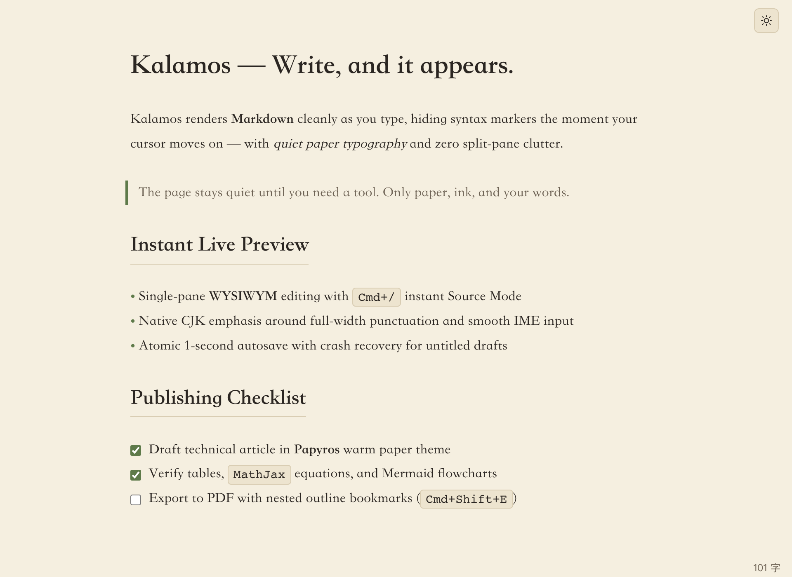
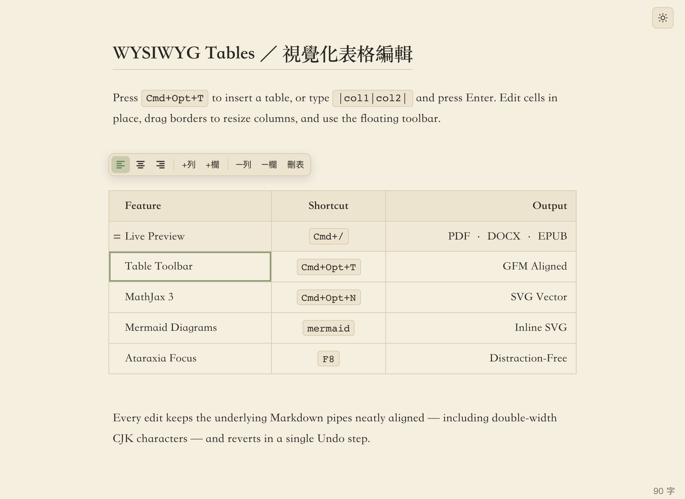
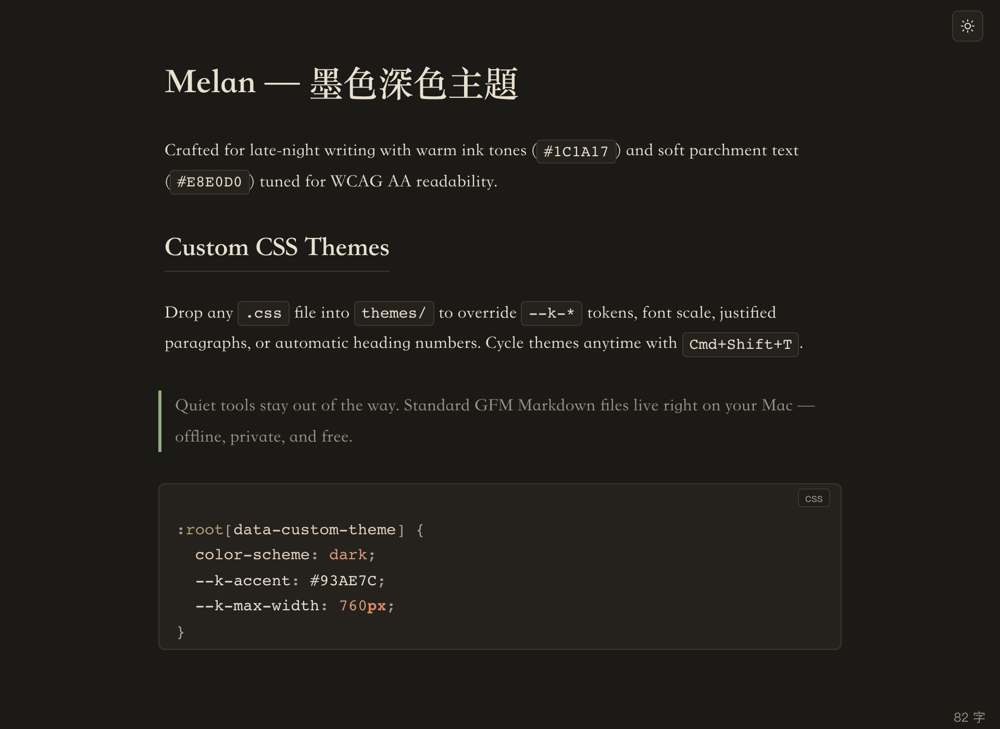
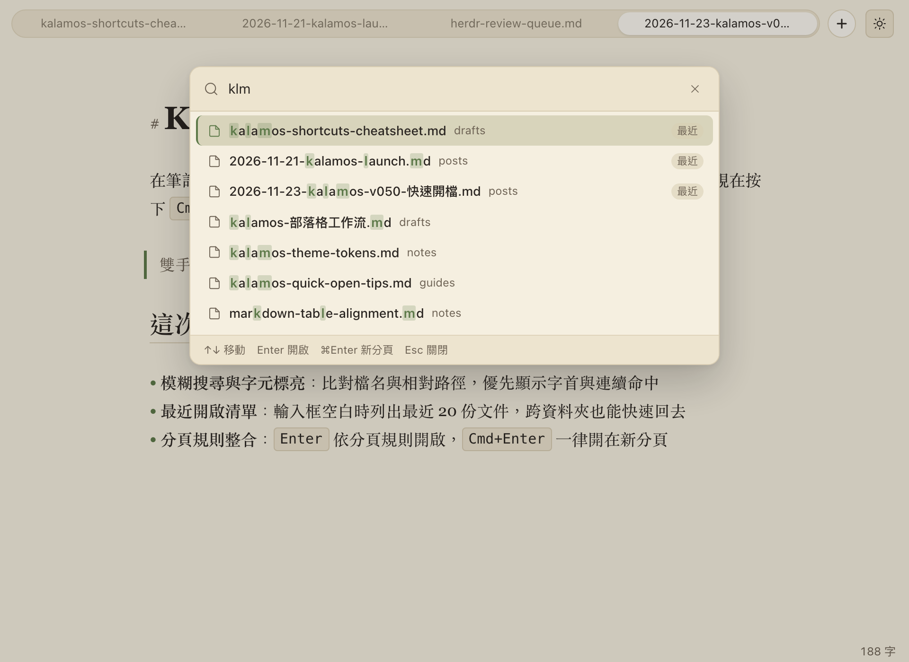

<p align="center">
  
</p>

<h1 align="center">Kalamos</h1>

<p align="center">
  <strong>Write, and it appears.</strong><br />
  A Typora-style WYSIWYM live-preview Markdown desktop editor for macOS & Windows, built with Tauri 2 and CodeMirror 6.<br />
  Free, offline, no account, no telemetry.
</p>

<p align="center">
  <strong>English</strong> ·
  <a href="README.zh-TW.md">繁體中文</a> ·
  <a href="README.ja.md">日本語</a> ·
  <a href="README.ko.md">한국어</a>
</p>

<p align="center">
  
</p>

> **Kalamos** (*κάλαμος*, pronounced *KA-la-mos*) is the Ancient Greek word for the reed pen used to write on papyrus. The interface stays out of your way until you need a tool, keeping your documents in standard, portable GitHub Flavored Markdown (GFM).

---

## Features

### Live Preview Editing (WYSIWYM)
- **Single-pane live preview** (`ED-01`): Headings, **bold**, *italic*, ~~strikethrough~~, `inline code`, links, blockquotes, horizontal rules, and lists render immediately as soon as the closing mark is typed; syntax markers hide when the cursor moves away and fade back in when you return.
- **Source Mode** (`ED-02`): Switch to raw Markdown anytime with `Cmd+/` while preserving your cursor position.
- **CJK & IME friendly**: CJK emphasis flanking works naturally next to full-width punctuation, and decorations freeze during IME composition to prevent layout jumps. Preserves original CRLF/LF line endings and UTF-8 BOM on unmodified saves.
- **Lists & Task Lists** (`ED-04`): Bullet, ordered, and interactive GFM task lists (`- [ ]` / `- [x]`) with clickable checkboxes, `Tab` / `Shift+Tab` indent and outdent, smart `Enter` / `Backspace` continuation and exit, and keyboard toggles.
- **Links & Heading Bookmarks** (`ED-05`): External URLs (`http://`, `https://`, `mailto:`), relative `.md` links, internal `#heading` anchor jumps, and `Cmd+Shift+C` to copy a heading bookmark link.
- **Rich Blocks & Live `[TOC]`** (`ED-06`, `ED-07`): Blockquotes, horizontal rules, YAML front matter rendered as a clickable document info card (supporting lists and nested fields) for in-place editing, footnotes with hover tooltips and click-to-jump navigation, and `[TOC]` auto-updating table of contents.
- **Emoji Autocomplete** (`ED-08`): Offline GitHub `gemoji` shortcode completion when typing `:name`, loaded lazily on first use.
- **Auto-Pairing** (`ED-09`): Automatic pairing of ASCII and CJK full-width brackets and quotes (`() [] {} "" ''` and `「」『』（）【】《》“”‘’`, enabled by default, `Cmd+Opt+P`), plus optional Markdown symbol pairing `* _ ` ~` (`Cmd+Opt+Shift+P`).

### Tables
- **Visual GFM Tables** (`BL-01`): Edit cells directly in place with `Tab`, `Shift+Tab`, and `Enter`; press `Cmd+Enter` to leave the table.
- **Fast Creation**: Press `Cmd+Opt+T` to open the Insert Table dialog (with grid picker and row/column inputs), or type `|a|b|` and press `Enter` to turn a pipe row into a table.
- **Floating Toolbar & Context Menu**: A non-overlapping toolbar floats above the active table (with scroll compensation so the current cell never jumps), plus a matching right-click menu.
- **Structure & Alignment**: Add/delete rows and columns, drag borders to resize columns, toggle left/center/right alignment, move columns left/right, delete tables, and revert any operation in a single Undo step. Automatically pads Markdown columns with double-width CJK support. See [docs/tables.md](docs/tables.md).

<p align="center">
  
</p>

### Math, Diagrams & Code Blocks
- **Code Blocks** (`BL-02`): Syntax highlighting for 100+ languages via `@codemirror/language-data` with low-saturation theme-matched colors and toggleable line numbers (`Cmd+Opt+L`).
- **Math Formulas** (`BL-03`): Offline MathJax 3 SVG rendering for inline `$...$` and display `$$...$$` equations with `ams`, `mhchem` (chemistry), `bbox`, and `newcommand` packages; lazy viewport-only rendering; live preview below the active block; optional AMS auto-numbering (`Cmd+Opt+N`).
- **Diagrams** (`BL-04`): Offline SVG rendering for `mermaid`, `flow` (flowchart.js syntax), and `sequence` (js-sequence-diagrams syntax) styled to match the active theme, with debounced live preview and line-numbered syntax error messages.

<p align="center">
  
</p>

### Images & Custom Upload
- **Inline Image Preview** (`IM-01`): Displays both local and remote images inline.
- **Drag-and-Drop & Clipboard Paste** (`IM-02`): Dropping or pasting images saves them into an `assets/` folder beside the document and inserts clean relative links.
- **Image Sizing** (`IM-03`): Supports HTML `` tags with `width`, `height`, and `style="zoom: ...%"`.
- **Image Root Folder** (`IM-04`): Resolve `/`-rooted paths for static site generators using `Cmd+Opt+R` (`Cmd+Opt+Shift+R` to clear) or YAML Front Matter `typora-root-url`.
- **Custom CLI Uploader** (`IM-05`): Press `Cmd+Opt+U` (or enable `uploadOnInsert`) to upload local images through any CLI tool such as PicGo CLI, configured exclusively via `settings.json` for security. See [docs/image-upload.md](docs/image-upload.md).

### Export & Import
- **Native PDF Export** (`EX-01`, `Cmd+Shift+E`): Paginates to A4 and embeds a nested PDF outline bookmark tree matching heading hierarchy, including rendered math and diagrams (uses `WKWebView` + `NSPrintOperation` + `PDFKit` on macOS, and headless Microsoft Edge or Google Chrome on Windows).
- **Pandoc Export** (`EX-02`, `Cmd+Opt+E`): Export to **DOCX**, **ODT** (OpenOffice / LibreOffice), **LaTeX**, **MediaWiki**, and **EPUB** (requires optional Pandoc). Resolves `[TOC]`, local image paths, and `` sizes automatically.
- **Pandoc Import** (`EX-03`, `Cmd+Opt+I`): Import **DOCX**, **ODT**, **EPUB**, **LaTeX**, **HTML**, and **MediaWiki** into clean GFM Markdown with `$...$` / `$$...$$` math and extracted media (requires Pandoc 2.15+ for `--sandbox`).

### Writing Modes
- **Ataraxia Focus Mode** (`WM-01`, `F8`): Softly dims every block outside the active paragraph, list item, or selection.
- **Stichos Typewriter Mode** (`WM-02`, `F9`): Keeps the active cursor line vertically centered while typing.

### Themes
- **Built-in Themes** (`TH-01`): **Papyros** (warm papyrus light), **Melan** (ink dark), and **System** auto-switching (`prefers-color-scheme`), paired with bundled open-source typography (`Source Serif 4`, `Noto Serif TC`, `Inter`, `Noto Sans TC`, `JetBrains Mono`).
- **Custom CSS Themes**: Place `.css` files in `~/Library/Application Support/io.kalamos.app/themes/` (macOS) or `%APPDATA%\io.kalamos.app\themes\` (Windows) to customize `--k-*` variables, typography, paragraph alignment, or automatic heading counters. Switch via the theme menu or `Cmd+Shift+T`. See [docs/themes.md](docs/themes.md).

<p align="center">
  
</p>

### Quick Open, Tabs, Search & Files
- **Quick Open & Recent Files** (`Cmd+P` / `Ctrl+P`): Fuzzy-search Markdown files across the open folder with highlighted match characters (prioritizing filename, prefix, and consecutive hits). With an empty input, lists up to 20 recently opened files across folders; press `Enter` to open following tab rules or `Cmd+Enter` / `Ctrl+Enter` to always open in a new tab. Also available under **File > Open Recent** (with **Clear Recent**) on macOS and Windows.
- **Multi-Document Tabs**: Work on multiple files in one window (`Cmd+T` / `Ctrl+T` new tab, `Cmd+W` / `Ctrl+W` close tab, `Ctrl+Tab` / `Ctrl+Shift+Tab` switch tabs, drag to reorder), each preserving independent undo history, cursor, and scroll position, with unsaved-change prompts before closing.
- **Find, Replace & Folder Search**: Search within the active document (`Cmd+F` / `Ctrl+F`), find and replace (`Cmd+Opt+F` / `Ctrl+Alt+F`), or search across every Markdown file in the open folder (`Cmd+Shift+F` / `Ctrl+Shift+F`) directly from the sidebar.
- **Native Menu Bar & Preferences**: Native application menu bar on both macOS and Windows, plus a Preferences window (`Cmd+,` / `Ctrl+,`) for general, editor, appearance, and image settings.
- **Interface Language**: Follows your system language on first launch or when not set (Traditional Chinese when the OS language starts with `zh`, English otherwise). You can switch between Traditional Chinese and English anytime in **Preferences → General → Interface language** (**偏好設定 → 一般 → 介面語言**). Choose **Restart Now** to apply it to the app and its native menu, or **Later** to apply it the next time you launch Kalamos.
- **Automatic Updates**: Checks for signed updates in the background shortly after launch (configurable in **Preferences → General**) or manually via **Kalamos > Check for Updates…** (macOS) / **Help > Check for Updates…** (Windows). Kalamos always asks before downloading, verifies cryptographic signatures, and prompts about unsaved documents before installing and restarting. *(Users on version `0.7.0` or earlier need to update manually once from GitHub Releases to enable in-app updates. Because macOS builds use ad-hoc signing, macOS Gatekeeper may ask you to re-authorize **Kalamos.app** after an update.)*
- **Interface Zoom**: Hold `Ctrl` and scroll the mouse wheel to zoom in or out smoothly (on both macOS and Windows), sharing the same zoom level with **View > Zoom In / Zoom Out / Actual Size** (`Cmd+Shift+=` / `-` / `0` or `Ctrl+Shift+=` / `-` / `0`).
- **Sidebar** (`NV-01`, `NV-02`): Toggle with `Cmd+Shift+L` / `Ctrl+Shift+L` and open folders with `Cmd+Shift+O` / `Ctrl+Shift+O`. Switch between **File Tree**, **File List** (with excerpts), **Outline** (`Cmd+Shift+1` / `Ctrl+Shift+1`), and **Folder Search**. Create, rename, and move files to Trash; watches external filesystem changes (compatible with iCloud Drive and Dropbox folders).
- **Word Count** (`NV-03`): Live status-bar count of reader-visible words (CJK + Latin), grapheme characters, lines, and estimated reading time, with automatic selection stats when text is highlighted.
- **Safe Saving & Crash Recovery**: Atomic temp-file + rename writes, 1-second debounced autosave for saved files, and 5-second crash-recovery snapshots for untitled drafts with a one-click restore banner on relaunch.

<p align="center">
  
</p>

---

## Keyboard Shortcuts

| Category | Action | macOS | Windows |
| --- | --- | --- | --- |
| **File & Tabs** | New document | `Cmd+N` | `Ctrl+N` |
| | New tab | `Cmd+T` | `Ctrl+T` |
| | Open file | `Cmd+O` | `Ctrl+O` |
| | Quick Open (fuzzy search & recent files) | `Cmd+P` | `Ctrl+P` |
| | Open folder in sidebar | `Cmd+Shift+O` | `Ctrl+Shift+O` |
| | Save / Save As | `Cmd+S` / `Cmd+Shift+S` | `Ctrl+S` / `Ctrl+Shift+S` |
| | Close tab | `Cmd+W` | `Ctrl+W` |
| | Next / previous tab | `Ctrl+Tab` / `Ctrl+Shift+Tab` | `Ctrl+Tab` / `Ctrl+Shift+Tab` |
| | Preferences | `Cmd+,` | `Ctrl+,` |
| **Search** | Find in document | `Cmd+F` | `Ctrl+F` |
| | Find and replace | `Cmd+Opt+F` | `Ctrl+Alt+F` |
| | Find next / previous | `Cmd+G` / `Cmd+Shift+G` | `Ctrl+G` / `Ctrl+Shift+G` |
| | Find in folder | `Cmd+Shift+F` | `Ctrl+Shift+F` |
| **View & Modes** | Toggle Source Mode | `Cmd+/` | `Ctrl+/` |
| | Toggle Sidebar | `Cmd+Shift+L` | `Ctrl+Shift+L` |
| | Toggle Outline | `Cmd+Shift+1` | `Ctrl+Shift+1` |
| | Cycle Theme | `Cmd+Shift+T` | `Ctrl+Shift+T` |
| | Ataraxia Focus Mode | `F8` | `F8` |
| | Stichos Typewriter Mode | `F9` | `F9` |
| | Zoom in / out / actual size | `Cmd+Shift+=` / `-` / `0` | `Ctrl+Shift+=` / `-` / `0` |
| | Zoom with mouse wheel | `Ctrl` + wheel | `Ctrl` + wheel |
| **Formatting** | Heading 1–6 / Paragraph | `Cmd+1`–`6` / `Cmd+0` | `Ctrl+1`–`6` / `Ctrl+0` |
| | Bold / Italic / Strikethrough | `Cmd+B` / `Cmd+I` / `Cmd+Shift+D` | `Ctrl+B` / `Ctrl+I` / `Ctrl+Shift+D` |
| | Inline code | `Cmd+Shift+`` ` `` | `Ctrl+Shift+`` ` `` |
| | Insert / toggle link | `Cmd+K` | `Ctrl+K` |
| | Ordered / Bullet / Task list | `Cmd+Shift+[` / `Cmd+Shift+]` / `Cmd+Shift+X` | `Ctrl+Shift+[` / `Ctrl+Shift+]` / `Ctrl+Shift+X` |
| | Indent / Outdent list item | `Tab` / `Shift+Tab` | `Tab` / `Shift+Tab` |
| | Copy heading bookmark link | `Cmd+Shift+C` | `Ctrl+Shift+C` |
| **Blocks & Code** | Code block / Math block / Blockquote | `Cmd+Opt+C` / `B` / `Q` | `Ctrl+Alt+C` / `B` / `Q` |
| | Toggle code line numbers | `Cmd+Opt+L` | `Ctrl+Alt+L` |
| | Toggle math auto-numbering | `Cmd+Opt+N` | `Ctrl+Alt+N` |
| | Toggle bracket / Markdown auto-pairing | `Cmd+Opt+P` / `Cmd+Opt+Shift+P` | `Ctrl+Alt+P` / `Ctrl+Alt+Shift+P` |
| **Tables** | Insert table dialog | `Cmd+Opt+T` | `Ctrl+Alt+T` |
| | Next / previous cell | `Tab` / `Shift+Tab` | `Tab` / `Shift+Tab` |
| | Leave table | `Cmd+Enter` | `Ctrl+Enter` |
| | Insert row above / below | `Cmd+Opt+↑` / `Cmd+Opt+↓` | `Ctrl+Alt+↑` / `Ctrl+Alt+↓` |
| | Insert column left / right | `Cmd+Opt+←` / `Cmd+Opt+→` | `Ctrl+Alt+←` / `Ctrl+Alt+→` |
| | Delete row / column | `Cmd+Shift+Backspace` / `Cmd+Opt+Backspace` | `Ctrl+Shift+Backspace` / `Ctrl+Alt+Backspace` |
| | Align column left / center / right | `Cmd+Opt+Shift+←` / `↑` / `→` | `Ctrl+Alt+Shift+←` / `↑` / `→` |
| **Images** | Set / clear image root folder | `Cmd+Opt+R` / `Cmd+Opt+Shift+R` | `Ctrl+Alt+R` / `Ctrl+Alt+Shift+R` |
| | Upload local images | `Cmd+Opt+U` | `Ctrl+Alt+U` |
| **Export & Import** | Export PDF (with bookmarks) | `Cmd+Shift+E` | `Ctrl+Shift+E` |
| | Export via Pandoc (DOCX/ODT/LaTeX/Wiki/EPUB) | `Cmd+Opt+E` | `Ctrl+Alt+E` |
| | Import via Pandoc | `Cmd+Opt+I` | `Ctrl+Alt+I` |

> **Inside Quick Open**: use `↑` / `↓` (or `Ctrl+N` / `Ctrl+P` on macOS) to navigate, `Enter` to open, `Cmd+Enter` / `Ctrl+Enter` to always open in a new tab, and `Esc` to close.

> **macOS wheel zoom note**: if **Accessibility → Zoom → Use scroll gesture with modifier keys to zoom** is enabled (the default modifier is `Control`), macOS will intercept `Ctrl` + wheel before it reaches Kalamos.

---

## System Requirements

- **macOS**: Apple Silicon (`aarch64`, M1 / M2 / M3 / M4) or Intel (`x64`).
- **Windows (Experimental)**: **Windows 10 / 11 (x64)** with **Microsoft Edge WebView2 Runtime** (pre-installed on Windows 11; automatically installed by the `.exe` / `.msi` installer bootstrapper on Windows 10). Headless A4 PDF export with bookmarks uses **Microsoft Edge** (or Google Chrome as fallback).
- **Optional**: **Pandoc** (2.15+ required for sandboxed import) for DOCX / ODT / LaTeX / MediaWiki / EPUB export and import.

## Installation

### macOS (Apple Silicon / Intel)

1. Download the `.dmg` for your Mac from [GitHub Releases](https://github.com/kkdai/Kalamos/releases/latest):
   - **Apple Silicon (M1 / M2 / M3 / M4)**: `Kalamos_<version>_aarch64.dmg`
   - **Intel Mac**: `Kalamos_<version>_x64.dmg`
   - *(Optional)* Verify checksums against `SHA256SUMS.txt`.
2. Open the `.dmg` and drag **Kalamos.app** into `/Applications`.
3. **Opening an unnotarized build**: Release builds use ad-hoc signing and are currently not Apple-notarized. On first launch, macOS Gatekeeper may block the app. To open it:
   - **Option A (Finder)**: Right-click (or Control-click) **Kalamos.app** → **Open** → confirm **Open** (or go to **System Settings → Privacy & Security** and click **Open Anyway**).
   - **Option B (Terminal)**: Clear the quarantine attribute:
     ```bash
     xattr -cr /Applications/Kalamos.app
     ```
4. **Make Kalamos the default for Markdown**: in Finder, select any `.md` file → **Get Info** (⌘I) → **Open with: Kalamos** → **Change All…**. Double-clicking a `.md` file, dropping one on the Dock icon, or `open -a Kalamos file.md` then opens it in Kalamos.

### Windows (x64 — Experimental)

> **Experimental & Unsigned**: Windows builds are currently **experimental** and **unsigned**. When running the installer, Windows Defender SmartScreen may display a warning — click **More info** → **Run anyway**.

1. Download a Windows installer from [GitHub Releases](https://github.com/kkdai/Kalamos/releases/latest):
   - **NSIS installer (recommended, no admin privileges required)**: `Kalamos_<version>_x64-setup.exe`
   - **MSI installer**: `Kalamos_<version>_x64_en-US.msi`
   - *(Optional)* Verify checksums against `SHA256SUMS.txt`.
2. Run the installer. If Windows Defender SmartScreen shows a warning, click **More info** → **Run anyway**.
3. **WebView2 & PDF export**: Windows 11 ships with **WebView2** and **Microsoft Edge**. On Windows 10 (especially LTSC or older builds), WebView2 may not be pre-installed — the `.exe` / `.msi` installers include the WebView2 bootstrapper to download and install it automatically. Headless A4 PDF export with document outline bookmarks uses Microsoft Edge (or Google Chrome as fallback).
4. **File associations**: The installer registers `.md`, `.markdown`, `.mdown`, `.mkd`, `.mkdn`, `.mdwn`, and `.mdtxt`; double-clicking or choosing **Open with Kalamos** in File Explorer opens the file in the running window.
5. **Settings & custom themes**: Stored in `%APPDATA%\io.kalamos.app\` (`settings.json` and `themes\*.css`).

---

## Building from Source

### Prerequisites
- **macOS** with Xcode Command Line Tools (`xcode-select --install`), or **Windows 10/11** with Visual Studio 2022 C++ Build Tools and WebView2
- **Node.js** 22+ and npm
- **Rust** stable toolchain (`rustup`)
- **Pandoc** *(optional)* — only needed for DOCX / ODT / LaTeX / MediaWiki / EPUB export and import (2.15+ required for import):
  ```bash
  # macOS
  brew install pandoc
  # Windows
  winget install JohnMacFarlane.Pandoc
  ```

### Build Commands
```bash
npm ci
npm run tauri build
```

The built installers will be generated under `src-tauri/target/release/bundle/` (`.app` and `.dmg` on macOS; `msi/*.msi` and `nsis/*-setup.exe` on Windows, with the standalone binary at `src-tauri/target/release/kalamos.exe`).

---

## Releases

See [docs/release.md](docs/release.md) for the release process.

---

## Development & Testing

```bash
# Run the frontend Vite dev server (port 1420, uses in-memory IPC mock in browser)
npm run dev

# Run the full Tauri desktop app in development mode
npm run tauri dev

# Type-check and build frontend assets
npm run build

# Frontend unit tests (Vitest)
npm test

# End-to-end tests (Playwright, headless Chromium against IPC mock)
npm run test:e2e

# Rust backend tests & linter
cargo test --manifest-path src-tauri/Cargo.toml
cargo clippy --manifest-path src-tauri/Cargo.toml --all-targets -- -D warnings

# 10,000-line document performance benchmark
npm run bench
```

### Development Tools (Biome & prek)

#### Formatting & Linting (Biome)

[Biome](https://biomejs.dev/) is pinned in `devDependencies` (installed by `npm ci`) and configured in [biome.json](biome.json):

```bash
# Check formatting and lint diagnostics
npm run lint

# Apply formatting and safe lint fixes
npm run format
```

#### Git Hooks (`prek`)

Install [prek](https://prek.j178.dev/installation/), run `npm ci` so the local `biome` and `tsc` hooks can resolve project binaries, and then run:

```bash
prek install                         # Install pre-commit hooks
prek install --hook-type pre-push    # Optional: install pre-push hooks (cargo clippy)
prek run                             # Check staged files now
prek run --all-files                 # Check all tracked files
```

[prek.toml](prek.toml) configures built-in file hygiene checks, [zizmor](https://docs.zizmor.sh/) for GitHub Actions security checks, local Biome checks (`npx biome check`), local TypeScript type checking (`npx tsc --noEmit`), and Rust Clippy on `pre-push`.

> **Existing hooks & git worktrees**: When `prek install` finds an existing `.git/hooks/pre-commit` hook (for example, a local privacy-scanning hook), it is expected to preserve the existing hook as `.git/hooks/pre-commit.legacy` and chain it alongside prek's hooks. **Do not pass `--overwrite` (or `-f`)**, which would delete the existing hook instead of chaining it. Note also that all `git worktree` checkouts share the same `.git/hooks` directory, so installing hooks in one worktree affects the main repository and every other worktree.

---

## Known Limitations

- **macOS & Windows (experimental)**: macOS uses `WKWebView`, `NSPrintOperation`, and `PDFKit` for bookmarked PDF export; Windows uses headless Microsoft Edge (or Google Chrome) to paginate onto A4 and build PDF outline bookmarks from `<h1>`–`<h6>`.
- **Preferences & CLI uploader config**: Preferences (`Cmd+,` / `Ctrl+,`) manage general, editor, appearance, and image settings and persist to `~/Library/Application Support/io.kalamos.app/settings.json` (`%APPDATA%\io.kalamos.app\settings.json` on Windows); for security, CLI image uploader commands (`uploadCommand`, `uploadArgs`) are edited directly in `settings.json`.
- **Pandoc is external**: Multi-format export (`EX-02`) and import (`EX-03`) require installing Pandoc separately (2.15+ for sandboxed import).
- **Unnotarized / unsigned builds**: Prebuilt macOS `.dmg` releases are not Apple-notarized (right-click **Kalamos.app** → **Open** on first launch); Windows builds are experimental and unsigned, triggering Windows SmartScreen (**More info** → **Run anyway**).
- **iPic preset**: macOS iPic is not built in as a preset; any CLI image uploader matching the stdout URL contract can be configured as `uploadCommand`.
- **Out of scope by design**: No accounts, cloud sync service (use local iCloud/Dropbox folders), real-time collaboration, plugin marketplace, or built-in AI assistant.

---

## Documentation

- Product Requirements: [docs/PRD.md](docs/PRD.md)
- Visual Tables Guide: [docs/tables.md](docs/tables.md)
- Custom CSS Themes Guide: [docs/themes.md](docs/themes.md)
- Custom Image Upload Guide: [docs/image-upload.md](docs/image-upload.md)

---

## Support

Kalamos is free and open source. If you enjoy using it, consider buying me a coffee to support the continued development of free software.

[](https://www.buymeacoffee.com/evanlin)

---

## License

Released under the [MIT License](LICENSE).
