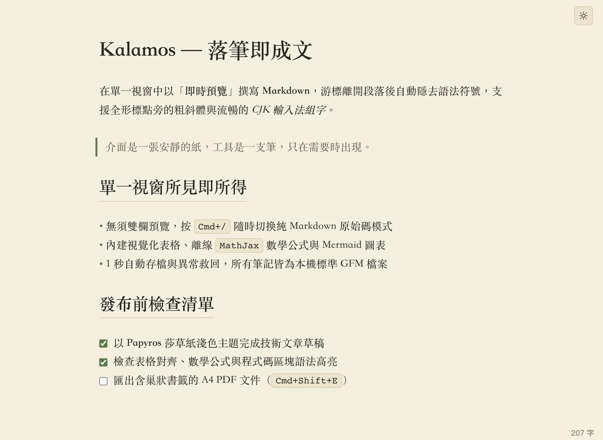
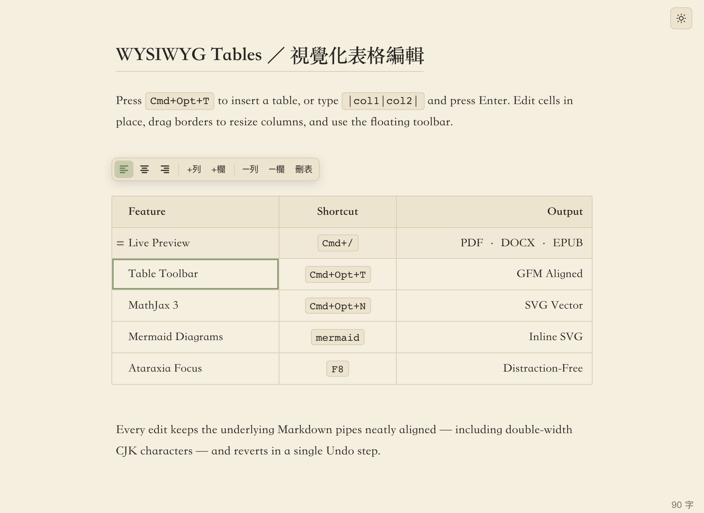
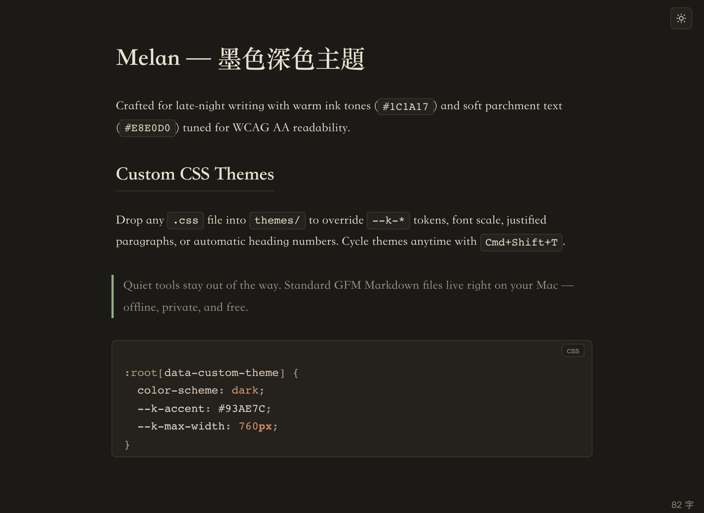

<p align="center">
  
</p>

<h1 align="center">Kalamos</h1>

<p align="center">
  <strong>Write, and it appears. ／ 落筆即成文</strong><br />
  Typora 風格的所見即所得（WYSIWYM）macOS / Windows Markdown 桌面編輯器，基於 Tauri 2 與 CodeMirror 6 打造。<br />
  免費、完全離線、免帳號、無遙測。
</p>

<p align="center">
  <a href="README.md">English</a> ·
  <strong>繁體中文</strong> ·
  <a href="README.ja.md">日本語</a> ·
  <a href="README.ko.md">한국어</a>
</p>

<p align="center">
  
</p>

> **Kalamos**（*κάλαμος*，讀音 *KA-la-mos*）是古希臘文「蘆葦筆」的意思。介面如一張安靜的莎草紙，工具只在需要時出現，所有文件都以標準可攜的 GitHub Flavored Markdown（GFM）儲存於本機。

---

## 功能一覽

### 即時預覽編輯（WYSIWYM）
- **單一視窗即時渲染**（`ED-01`）：標題、**粗體**、*斜體*、~~刪除線~~、`行內程式碼`、連結、引用、水平線與清單在輸入結尾符號的當下立即渲染；游標移開時自動隱藏語法符號，回到該區塊時柔和浮現。
- **原始碼模式**（`ED-02`）：按 `Cmd+/` 隨時切換純 Markdown 原始碼，並保留游標位置。
- **中英混排與輸入法友善**：完整支援中文全形標點旁的粗斜體解析；CJK 輸入法組字期間凍結裝飾更新避免畫面跳動；未修改內容直接存檔時原樣保留 CRLF/LF 換行與 UTF-8 BOM。
- **清單與任務清單**（`ED-04`）：支援項目符號清單、編號清單與可點擊勾選的 GFM 任務清單（`- [ ]` / `- [x]`）；`Tab` / `Shift+Tab` 縮排調整層級，智慧 `Enter` / `Backspace` 延續或跳出清單與引用，並提供清單類型切換快捷鍵。
- **連結與標題書籤**（`ED-05`）：支援外部網址（`http://`、`https://`、`mailto:`）、相對路徑 `.md` 連結、文內 `#標題` 錨點跳轉，以及 `Cmd+Shift+C` 複製標題書籤連結。
- **進階區塊與即時目錄 `[TOC]`**（`ED-06`、`ED-07`）：支援引用區塊、水平線、YAML Front Matter、滑鼠懸停預覽且可點擊跳轉的註腳，以及隨標題即時更新的 `[TOC]` 目錄。
- **Emoji 自動完成**（`ED-08`）：輸入 `:名稱` 離線提示 GitHub `gemoji` 候選清單（首次觸發才延遲載入）。
- **自動配對**（`ED-09`）：預設自動配對半形與中文全形括號引號（`() [] {} "" ''` 與 `「」『』（）【】《》“”‘’`，`Cmd+Opt+P` 切換），另可選配 Markdown 符號 `* _ ` ~` 自動配對（`Cmd+Opt+Shift+P`）。

### 表格
- **所見即所得 GFM 表格**（`BL-01`）：直接在表格儲存格內編輯文字，支援 `Tab` / `Shift+Tab` / `Enter` 移動游標，按 `Cmd+Enter` 跳出表格。
- **快速插入**：按 `Cmd+Opt+T` 開啟「插入表格」對話框（支援格線預覽選取或輸入列數與欄數），或在段落行尾輸入 `|a|b|` 後按 `Enter` 直接轉成表格。
- **浮動工具列與右鍵選單**：游標進入表格時，上方自動保留空間顯示浮動工具列（不遮擋文字、捲動位置不跳動），並提供完整右鍵選單。
- **結構與對齊操作**：支援增刪列與欄、拖曳欄界調整寬度、靠左／置中／靠右切換、左右移動欄位、刪除表格，所有操作皆為單一步驟復原，並依中文全形字寬（寬度 2）自動對齊原始碼管線。詳見 [docs/tables.md](docs/tables.md)。

<p align="center">
  
</p>

### 數學公式、圖表與程式碼區塊
- **程式碼區塊**（`BL-02`）：內建 100 種以上程式語言語法高亮（`@codemirror/language-data`），搭配低飽和度主題配色，並可隨時切換行號顯示（`Cmd+Opt+L`）。
- **數學公式**（`BL-03`）：離線 MathJax 3 SVG 渲染行內 `$...$` 與區塊 `$$...$$` 公式，內建 `ams`、`mhchem`（化學式）、`bbox` 與 `newcommand` 擴充；僅渲染視口內可見公式；編輯區塊公式時於下方即時預覽；可切換 AMS 自動連續編號（`Cmd+Opt+N`）。
- **圖表渲染**（`BL-04`）：支援 `mermaid`、`flow`（flowchart.js 語法）與 `sequence`（js-sequence-diagrams 語法），離線渲染為與主題色票一致的淨化 SVG，並提供即時預覽與附帶行號的語法錯誤提示。

<p align="center">
  
</p>

### 圖片與圖床上傳
- **行內圖片預覽**（`IM-01`）：直接於文內顯示本機與遠端圖片。
- **拖放與剪貼簿貼上**（`IM-02`）：拖入或貼上圖片時自動複製到文件旁的 `assets/` 資料夾並寫入相對路徑連結。
- **圖片尺寸調整**（`IM-03`）：支援以 HTML `` 標籤指定 `width`、`height` 或 `style="zoom: ...%"` 縮放比例。
- **圖片根目錄**（`IM-04`）：按 `Cmd+Opt+R` 設定（`Cmd+Opt+Shift+R` 清除）或在 YAML Front Matter 設定 `typora-root-url`，讓 `/img/a.png` 這類根路徑在靜態部落格寫作時正確解析。
- **自訂上傳指令**（`IM-05`）：按 `Cmd+Opt+U`（或開啟 `uploadOnInsert`）呼叫外部 CLI 工具（如 PicGo CLI）上傳本機圖片並自動替換為遠端網址；基於安全考量，上傳指令僅能透過 `settings.json` 設定。詳見 [docs/image-upload.md](docs/image-upload.md)。

### 匯出與匯入
- **原生 PDF 匯出**（`EX-01`，`Cmd+Shift+E`）：透過隱藏且停用 JavaScript 的 macOS `WKWebView` 與 `NSPrintOperation` 進行 A4 分頁，並以 `PDFKit` 自動寫入對應標題層級的巢狀 PDF 書籤，完整保留數學公式與圖表。
- **Pandoc 多格式匯出**（`EX-02`，`Cmd+Opt+E`）：支援匯出 **DOCX**、**ODT**（OpenOffice / LibreOffice）、**LaTeX**、**MediaWiki** 與 **EPUB**（需選用安裝 Pandoc），自動轉換 `[TOC]`、本機圖片路徑與 `` 尺寸。
- **Pandoc 匯入**（`EX-03`，`Cmd+Opt+I`）：可將 **DOCX**、**ODT**、**EPUB**、**LaTeX**、**HTML** 與 **MediaWiki** 匯入為乾淨的 GFM Markdown，保留 `$...$` / `$$...$$` 數學公式並提取內嵌媒體（需 Pandoc 2.15 以上以啟用 `--sandbox`）。

### 寫作模式
- **Ataraxia 專注模式**（`WM-01`，`F8`）：柔和淡化當前段落、清單項目或選取範圍以外的所有區塊。
- **Stichos 打字機模式**（`WM-02`，`F9`）：打字與移動游標時始終讓當前行維持於畫面垂直中央。

### 主題系統
- **內建主題**（`TH-01`）：提供 **Papyros（莎草紙，淺色）**、**Melan（墨，深色）** 與 **跟隨系統外觀**，並內建開源中英文字體（`Source Serif 4`、`Noto Serif TC`、`Inter`、`Noto Sans TC`、`JetBrains Mono`）。
- **自訂 CSS 主題**：將 `.css` 檔案放入 `~/Library/Application Support/io.kalamos.app/themes/` 即可覆寫 `--k-*` 色彩與排版變數、兩端對齊或標題自動編號，可由主題選單或 `Cmd+Shift+T` 循環切換。詳見 [docs/themes.md](docs/themes.md)。

<p align="center">
  
</p>

### 檔案管理、側欄與資料安全
- **側欄導覽**（`NV-01`、`NV-02`）：`Cmd+Shift+L` 切換側欄、`Cmd+Shift+O` 開啟資料夾，內建**檔案樹**、**檔案列表**（含摘要）與**大綱**三種分頁；支援新增、重新命名與移至垃圾桶，並監聽外部檔案變更（相容 iCloud Drive 與 Dropbox 資料夾）。
- **即時字數統計**（`NV-03`）：狀態列顯示讀者可見字數（CJK 字元 + 英文單字）、字元數、行數與預估閱讀時間，框選文字時即時切換為選取範圍統計。
- **安全存檔與異常救回**：採用暫存檔原子更名寫入；已命名文件停止輸入 1 秒後自動存檔；未命名草稿每 5 秒寫入救回快照，異常關閉重開後可一鍵還原。

---

## 快捷鍵一覽

| 分類 | 功能 | 快捷鍵 |
| --- | --- | --- |
| **檔案** | 新增文件 | `Cmd+N` |
| | 開啟檔案 | `Cmd+O` |
| | 儲存 / 另存新檔 | `Cmd+S` / `Cmd+Shift+S` |
| | 開啟資料夾至側欄 | `Cmd+Shift+O` |
| **檢視與模式** | 切換原始碼模式 | `Cmd+/` |
| | 顯示 / 隱藏側欄 | `Cmd+Shift+L` |
| | 循環切換主題 | `Cmd+Shift+T` |
| | Ataraxia 專注模式 | `F8` |
| | Stichos 打字機模式 | `F9` |
| **行內與清單** | 粗體 / 斜體 | `Cmd+B` / `Cmd+I` |
| | 行內程式碼 | `Cmd+Shift+`` ` `` |
| | 插入 / 切換超連結 | `Cmd+K` |
| | 編號 / 項目符號 / 任務清單 | `Cmd+Shift+[` / `Cmd+Shift+]` / `Cmd+Shift+X` |
| | 列表縮排 / 反縮排 | `Tab` / `Shift+Tab` |
| | 複製標題書籤連結 | `Cmd+Shift+C` |
| **區塊與輸入** | 切換程式碼行號 | `Cmd+Opt+L` |
| | 切換公式自動編號 | `Cmd+Opt+N` |
| | 切換括號 / Markdown 符號自動配對 | `Cmd+Opt+P` / `Cmd+Opt+Shift+P` |
| **表格** | 開啟插入表格對話框 | `Cmd+Opt+T` |
| | 移至下一格 / 上一格 | `Tab` / `Shift+Tab` |
| | 跳出表格 | `Cmd+Enter` |
| | 上方 / 下方插入列 | `Cmd+Opt+↑` / `Cmd+Opt+↓` |
| | 左側 / 右側插入欄 | `Cmd+Opt+←` / `Cmd+Opt+→` |
| | 刪除列 / 刪除欄 | `Cmd+Shift+Backspace` / `Cmd+Opt+Backspace` |
| | 欄靠左 / 置中 / 靠右對齊 | `Cmd+Opt+Shift+←` / `↑` / `→` |
| **圖片** | 設定 / 清除圖片根目錄 | `Cmd+Opt+R` / `Cmd+Opt+Shift+R` |
| | 上傳本機圖片至圖床 | `Cmd+Opt+U` |
| **匯出與匯入** | 匯出 PDF（含書籤） | `Cmd+Shift+E` |
| | 透過 Pandoc 匯出（DOCX/ODT/LaTeX/Wiki/EPUB） | `Cmd+Opt+E` |
| | 透過 Pandoc 匯入文件 | `Cmd+Opt+I` |

> **Windows 快捷鍵對照**：上表所有 `Cmd` 對應 `Ctrl`、`Opt` 對應 `Alt`（例如 `Cmd+Opt+T` 在 Windows 為 `Ctrl+Alt+T`）。

---

## 安裝方式（Windows，實驗性）

> Windows 支援目前為**實驗性**且**尚未簽章**（首次執行時 Windows SmartScreen 會跳出警告）。GitHub Releases 尚未提供預先建置的 Windows 安裝檔（即將推出），目前請先從原始碼建置。

1. 依下方[從原始碼建置](#從原始碼建置)步驟建置 Windows 安裝檔（`.msi` 或 `-setup.exe`）。
2. **WebView2 與 PDF 匯出**：Windows 11 已內建 **WebView2** 與 **Microsoft Edge**；部分 Windows 10 環境（例如 LTSC 或未更新的系統）可能未預載 WebView2，MSI／NSIS 安裝程式已內含 WebView2 bootstrapper。無頭 A4 PDF 匯出與書籤生成會使用 Microsoft Edge（或以 Google Chrome 作為備援）。
3. 安裝程式會自動註冊 `.md`、`.markdown`、`.mdown`、`.mkd`、`.mkdn`、`.mdwn`、`.mdtxt` 檔案關聯；在檔案總管雙擊或選擇「以 Kalamos 開啟」即可直接於執行中的視窗開啟。
4. 設定檔與自訂主題目錄位於 `%APPDATA%\io.kalamos.app\`（`settings.json` 與 `themes\*.css`）。

## 安裝方式（macOS）

1. 前往 [GitHub Releases](https://github.com/kkdai/Kalamos/releases) 下載最新 `.dmg` 安裝檔。
2. 開啟 `.dmg`，將 **Kalamos.app** 拖曳至 `/Applications` 資料夾。
3. **開啟未簽章的應用程式**：目前發佈版尚未進行 Apple 公證，首次開啟時可能會遇到 macOS Gatekeeper 阻擋，請用以下任一方式放行：
   - **方法一（Finder）**：在 **Kalamos.app** 上按右鍵（或 Control+點擊）→ 選擇「**打開**」→ 確認打開（或至 **系統設定 → 隱私權與安全性** 點選「**仍要打開**」）。
   - **方法二（終端機）**：移除隔離屬性：
     ```bash
     xattr -cr /Applications/Kalamos.app
     ```
4. **設為 .md 預設 app**：在 Finder 選取任一 `.md` 檔 →「**取得資訊**」（⌘I）→「**打開檔案的應用程式**」選 **Kalamos** →「**全部更改…**」。之後雙擊 `.md`、拖到 Dock 圖示或 `open -a Kalamos 檔案.md` 都會用 Kalamos 開啟。

---

## 從原始碼建置

### 環境需求
- **macOS**（Xcode Command Line Tools：`xcode-select --install`）或 **Windows 10/11**（Visual Studio 2022 C++ Build Tools 與 WebView2）
- **Node.js** 22 以上與 npm
- **Rust** stable 工具鏈（`rustup`）
- **Pandoc** *（選用）* —— 僅在使用 DOCX / ODT / LaTeX / MediaWiki / EPUB 匯出與匯入時需要（匯入需 2.15 以上）：
  ```bash
  # macOS
  brew install pandoc
  # Windows
  winget install JohnMacFarlane.Pandoc
  ```

### 建置指令
```bash
npm ci
npm run tauri build
```

建置完成後，安裝包會輸出在 `src-tauri/target/release/bundle/`（macOS 為 `.app` / `.dmg`；Windows 為 `msi/*.msi` 與 `nsis/*-setup.exe`，可直接執行的主程式在 `src-tauri/target/release/kalamos.exe`）。

---

## 開發與測試指令

```bash
# 啟動前端 Vite 開發伺服器（port 1420，瀏覽器中使用記憶體 IPC mock）
npm run dev

# 啟動完整 Tauri 桌面應用程式（開發模式）
npm run tauri dev

# TypeScript 型別檢查與前端建置
npm run build

# 前端單元測試（Vitest）
npm test

# 端對端測試（Playwright，使用 IPC mock）
npm run test:e2e

# Rust 後端測試與靜態檢查
cargo test --manifest-path src-tauri/Cargo.toml
cargo clippy --manifest-path src-tauri/Cargo.toml --all-targets -- -D warnings

# 1 萬行大型文件效能基準測試
npm run bench
```

---

## 已知限制

- **平台支援（macOS 與實驗性 Windows）**：macOS 使用 `WKWebView`、`NSPrintOperation` 與 `PDFKit` 匯出含書籤的 PDF；Windows 使用系統內建的無頭 Microsoft Edge（或 Google Chrome）渲染 A4 PDF 並自動由 `<h1>`–`<h6>` 產生 PDF 書籤大綱。
- **偏好設定與圖床上傳設定**：多數一般、編輯器、外觀與圖片設定皆可在偏好設定視窗（`Cmd+,` / `Ctrl+,`）調整並自動儲存於 `~/Library/Application Support/io.kalamos.app/settings.json`（Windows 為 `%APPDATA%\io.kalamos.app\settings.json`）；基於安全考量，圖床上傳指令（`uploadCommand`、`uploadArgs`）仍需直接編輯該檔案。
- **Pandoc 為外部選用相依**：多格式匯出（`EX-02`）與匯入（`EX-03`）需自行安裝 Pandoc（匯入需 2.15 以上以支援 `--sandbox`）。
- **未簽章建置**：macOS `.dmg` 首次啟動時需手動通過 Gatekeeper 驗證；Windows 建置目前未簽章，執行時會觸發 SmartScreen 警告。
- **iPic 預設整合**：尚未內建 macOS iPic 預設設定；任何符合 stdout 網址輸出規則的命令列上傳工具皆可作為 `uploadCommand` 使用。
- **刻意不納入的範疇**：不設帳號、不內建雲端同步（請搭配 iCloud / Dropbox 本機資料夾）、不做多人協作、外掛市集或內建 AI 寫作輔助。

---

## 相關文件

- 產品規格書：[docs/PRD.md](docs/PRD.md)
- 表格操作說明：[docs/tables.md](docs/tables.md)
- 自訂 CSS 主題指南：[docs/themes.md](docs/themes.md)
- 圖床上傳設定說明：[docs/image-upload.md](docs/image-upload.md)

---

## 授權

以 [MIT 授權](LICENSE) 釋出。
