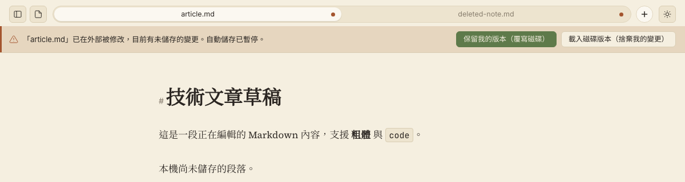

# 外部修改偵測（External Changes）

用 Kalamos 開著一份文件時，同一個檔案也可能被其他程式修改：另一個編輯器、`git pull` 或切換分支、腳本產生的內容，或是 iCloud Drive、Dropbox 從另一台電腦同步過來的版本。Kalamos 會監看所有已開啟的檔案，在這些情況下自動重新載入或提醒你，避免在不知情的狀況下覆寫別人的修改，或繼續編輯一個已經不存在的檔案。

  

## 什麼時候會檢查

- **檔案變動時**：Kalamos 會監看所有分頁中已命名的檔案（包含不在側欄資料夾內的檔案），磁碟上的檔案被修改、取代、刪除或改名時就會檢查。
- **回到 Kalamos 時**：視窗重新取得焦點時，也會再檢查一次所有已開啟的檔案，補上監看可能漏掉的變動。
- **存檔前**：每次存檔（包含自動存檔）前，都會先比對磁碟內容是否仍與上次開啟或存檔時相同。
- Kalamos 自己寫入的存檔不會被誤判為外部修改。
- 未命名的新文件沒有對應的檔案，不會進行檢查。

## 三種情況

### 1. 沒有未儲存的變更：自動重新載入

若你在 Kalamos 中沒有尚未儲存的修改，磁碟上的新內容會直接載入分頁，並盡量保留游標與捲動位置，狀態列會顯示「已從磁碟重新載入」。在背景分頁中的文件也會同步更新。

### 2. 有未儲存的變更：顯示衝突橫幅

若磁碟內容被改動，而你在 Kalamos 中也有尚未儲存的修改，編輯區上方會出現衝突橫幅，**這個分頁的自動儲存會暫停**，直到你做出選擇：

- **保留我的版本（覆寫磁碟）**：把目前編輯器的內容寫入磁碟，取代外部的修改。若有開啟 [本機版本歷史](version-history.md)，被覆寫的外部內容會先保留成一個歷史版本，之後仍可找回。
- **載入磁碟版本（捨棄我的變更）**：載入磁碟上的新內容，放棄在 Kalamos 中尚未儲存的修改。

橫幅不會阻擋編輯，你可以先繼續寫或複製需要的段落，再決定要保留哪一邊。若外部程式又把檔案改回與你目前內容（或上次存檔時）相同，衝突會自動解除。

### 3. 檔案被刪除或改名：提示檔案已不存在

若檔案在 Kalamos 以外被刪除、改名或搬移（包含所在資料夾被改名或刪除），編輯區上方會顯示提示橫幅，**自動儲存同樣會暫停**，避免在原路徑默默建立一份新檔：

- **另存新檔…**：把目前內容存到新的位置（例如檔案被改名後的新路徑）。
- **在原路徑重新建立**：用目前編輯器的內容在原本的路徑重新寫出檔案。

如果檔案之後又出現在原路徑（例如從垃圾桶復原），Kalamos 會重新比對內容：與你目前的內容或上次存檔時相同就自動解除提示，不同則依前兩種情況處理。

## 存檔前的比對

即使監看漏掉了某次變動，存檔前的比對也能避免覆寫外部修改：

- 存檔時若發現磁碟內容已與上次開啟或存檔時不同，Kalamos **不會寫入**，而是改為顯示上面的衝突橫幅。
- 存檔時若發現檔案已不存在，Kalamos **不會在原路徑重新建立檔案**，而是顯示「檔案已不存在」的提示。
- 只有在你按下「保留我的版本（覆寫磁碟）」或「在原路徑重新建立」時，才會略過比對並直接寫入。

## 分頁與關閉提示

- 有未解決的衝突，或檔案已不存在的分頁，滑鼠移到分頁上時會在提示文字中標示「外部已修改（有衝突）」或「磁碟上的檔案已不存在」。
- 這類分頁即使沒有未儲存的變更，關閉分頁、視窗或結束 Kalamos 時也會先詢問，避免內容在你不注意時遺失。

## 相關說明

- 比對以檔案內容的 SHA-256 雜湊為準，不依賴修改時間，所以只更新修改時間（例如 `touch`）而內容沒變時不會觸發提示。
- 這個功能只監看已開啟的檔案，整個過程都在本機進行，不需要網路。
- 想找回被覆寫或捨棄的內容，可以使用 **檔案 > 瀏覽版本歷史…**，詳見 [本機版本歷史](version-history.md)。
