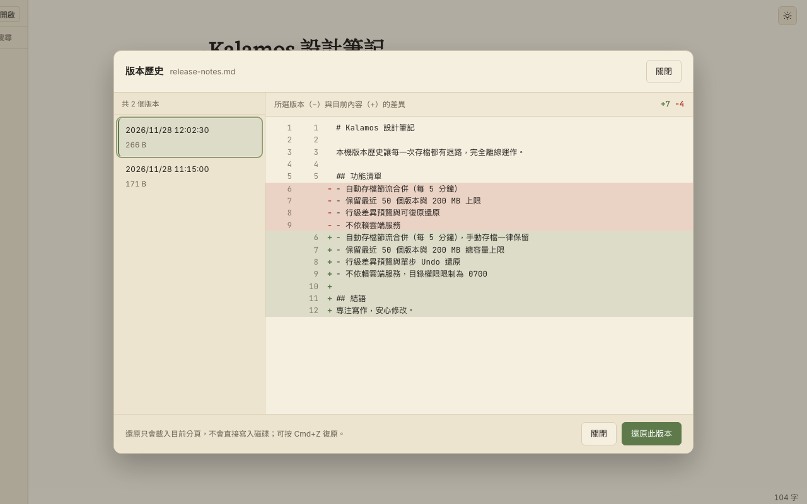

# 本機版本歷史（Local Version History）

Kalamos 會在每次存檔前，把磁碟上即將被覆寫的舊內容另外保留一份在本機。寫錯、刪錯或想找回幾小時前的段落時，可以打開版本歷史比對差異，再把舊版本還原到目前分頁。整個功能完全離線，歷史版本只存在你的電腦上，不會上傳到任何地方。

<p align="center">
  
</p>

## 使用方式

- **開啟**：**檔案 > 瀏覽版本歷史…**（English: **File > Browse Version History…**），macOS 與 Windows 皆提供，沒有預設快捷鍵。
- **適用範圍**：只適用於已經存成檔案的文件。未命名的新文件請先存檔，之後的修改才會留下歷史版本。
- **版本列表**：左側依時間由新到舊列出這個檔案的所有版本，顯示存檔時間與大小。
- **差異比對**：選取任一版本後，右側會以行為單位顯示「所選版本（−）」與「目前編輯器內容（+）」的差異，並統計新增與刪除的行數；兩者完全相同時會標示「與目前內容完全相同」。
- **還原**：按 **還原此版本**，所選版本的內容會載入目前分頁：
  - **不會直接寫入磁碟**。還原後文件會標示為未儲存，確認無誤後再按 `Cmd+S`／`Ctrl+S` 存檔。
  - **可以復原**。還原是一次普通的編輯，按 `Cmd+Z`／`Ctrl+Z` 就能回到還原前的內容。
  - 下次存檔時，被覆寫的磁碟內容也會照常保留成一個新的歷史版本，所以還原本身不會讓任何版本消失。

## 什麼時候會保留版本

版本是在**寫入磁碟之前**建立的，保留的是「存檔前磁碟上的內容」：

- **手動存檔**（`Cmd+S`／`Ctrl+S`）與關閉文件時的存檔：每次都會保留一個版本。
- **自動存檔**：已命名的文件停止輸入約 1 秒後會自動存檔（可在偏好設定關閉）。為了避免每 1 秒就產生一個版本，自動存檔對同一個檔案**每 5 分鐘最多保留一個版本**。
- **以下情況不會產生新版本**：
  - 磁碟內容與要寫入的內容完全相同（沒有實際修改）。
  - 磁碟內容與最近一個歷史版本完全相同（避免重複）。
  - 檔案原本不存在（例如第一次「另存新檔」）。
  - 在偏好設定中關閉了版本歷史。
- **外部修改衝突時**：在衝突橫幅選擇「保留我的版本（覆寫磁碟）」時，被覆寫的外部修改也會先保留成一個歷史版本，之後仍可從版本歷史找回。詳見 [外部修改偵測](external-changes.md)。

## 上限與自動清理

在 **偏好設定 → 一般 → 版本歷史** 可以調整兩個上限：

| 設定 | 預設值 | 可設定範圍 | 超過時的處理方式 |
| --- | --- | --- | --- |
| **每個檔案保留上限** | 50 個版本 | 1–500 | 刪除該檔案最舊的版本 |
| **總容量上限（MB）** | 200 MB | 10–2048 | 跨所有檔案，從全部版本中最舊的開始刪除，直到總量低於上限 |

- 偏好設定中會顯示目前已使用的容量與版本數。
- 單一版本若本身就超過總容量上限，將不會被保留。

## 開啟、關閉與清除

在 **偏好設定 → 一般 → 版本歷史**：

- **存檔時在本機保留舊版本**：預設開啟。關閉後不會再產生新的版本，但已保存的歷史仍會保留，也仍可從「檔案 > 瀏覽版本歷史…」瀏覽與還原。
- **清除所有歷史**：刪除所有檔案的本機版本歷史（整個 `history/` 資料夾）。確認後無法復原。

## 儲存位置與隱私

歷史版本存放在 Kalamos 應用程式資料目錄下的 `history/` 資料夾：

- **macOS**：
  ```text
  ~/Library/Application Support/io.kalamos.app/history/
  ```
- **Windows**：
  ```text
  %APPDATA%\io.kalamos.app\history\
  ```

資料夾結構：

```text
history/
└── <檔案路徑的 SHA-256>/
    ├── meta.json          # 原始檔案路徑與版本清單
    ├── 1764302550123.md   # 各版本的完整內容，檔名為存檔時間（毫秒）
    └── …
```

- **只存在本機**：Kalamos 不會上傳、同步或備份這些檔案。
- **權限**：在 macOS（Unix）上，`history/` 與各檔案的子資料夾權限為 `0700`、版本檔案為 `0600`，只有你的使用者帳號能讀取。
- **以路徑辨識檔案**：版本歷史依檔案的完整路徑分組。在 Kalamos 以外把檔案改名或搬移後，新路徑會從空白的版本歷史開始；舊路徑的歷史仍會保留，直到被上限清理或手動清除。
- `meta.json` 以純文字記錄原始檔案路徑。若你要把應用程式資料目錄交給他人或備份到其他地方，請留意這一點。
- 版本檔案就是一般的 Markdown 文字檔，必要時也可以直接用其他編輯器開啟。
