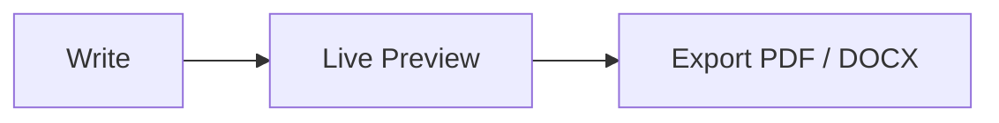

# Welcome to Kalamos

Kalamos is a calm, local-first Markdown editor. Click any block to edit its raw Markdown, and move the cursor away to see clean **live preview**—including *italics*, **bold**, and `inline code`.

> This is an untitled sample document and is not saved to disk. Feel free to experiment—you can reopen it anytime from Help > Welcome Document.

- [x] Live preview and YAML front matter (click the card above to edit)
- [ ] Press {{shortcuts}} to open the full Keyboard Shortcuts cheatsheet

## Essential Shortcuts & Tables

| Shortcut | Action |
| --- | --- |
| {{quickOpen}} | Quick Open file |
| {{newTab}} | New tab |
| {{sourceMode}} | Toggle Source Mode |
| {{shortcuts}} | Keyboard Shortcuts cheatsheet |

## Math Equations

Write inline math like $E = mc^2$ or display equations:

$$
\int_0^\infty e^{-x^2}\,dx = \frac{\sqrt{\pi}}{2}
$$

## Code Blocks

```ts
export function greet(name: string): string {
  return `Hello, ${name}!`;
}
```

## Diagrams (Mermaid)


