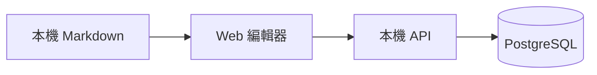

# Local-first 工作區

Kalamos 在瀏覽器編輯 Markdown，內容存入自己的 PostgreSQL，不改寫匯入的原檔。

## 文件怎麼保存

## 寫作檢查

- [x] 匯入原稿與圖片附件
- [x] 在同一欄預覽並編輯
- [ ] 儲存後，從新視窗重開文件

| 操作 | 結果 |
| --- | --- |
| 儲存 | 更新工作區內的文件 |
| 下載 | 取得獨立的 Markdown 副本 |
